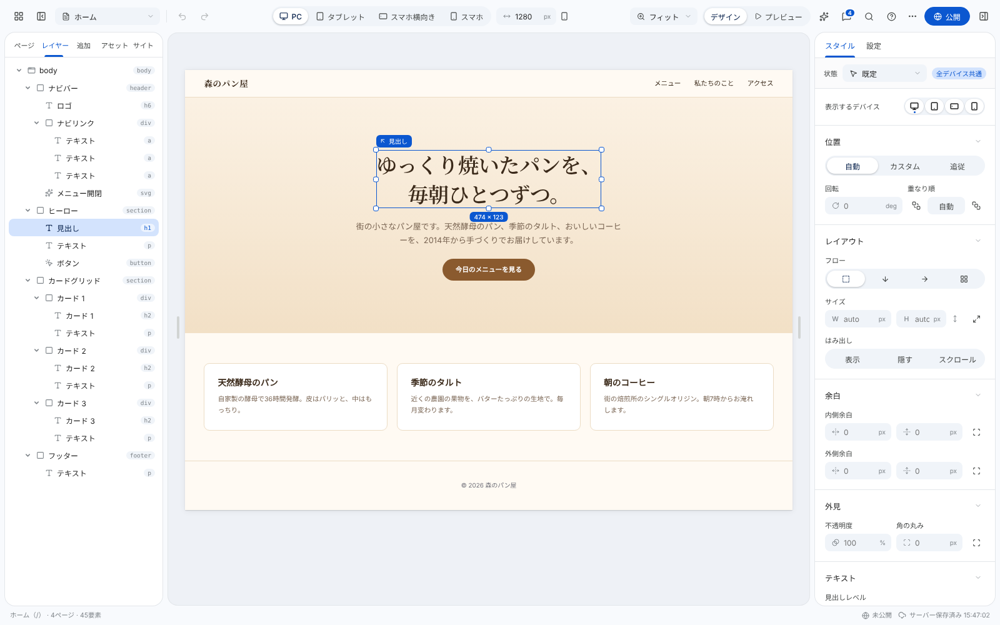
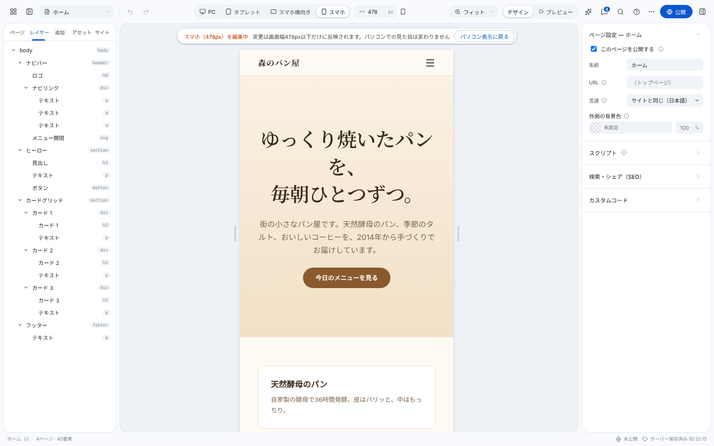

<p align="center">
  <picture>
    <source media="(prefers-color-scheme: dark)" srcset="docs/tsumu-logo-dark.svg">
    
  </picture>
</p>

<p align="center">
  <strong>Design freely. Build openly.</strong><br>
  オープンソースのノーコードWebサイトエディタ
</p>

<p align="center">
  <a href="LICENSE"></a>
  
  
  
  
  
  <a href=".github/CONTRIBUTING.ja.md"></a>
</p>

<p align="center">
  <a href="https://tsumu.ebii.net"><strong>デモを試す</strong></a> · <a href="README.md">English</a> · 日本語
</p>

<p align="center">
  
</p>

Tsumu を使うと、ドラッグなどの直感的な操作だけで Web サイトを作成できます。標準的なプロジェクトとして書き出し・公開できるため、**Tsumu に依存せず** 任意の環境でホスティングやコードの編集ができます。

## 特徴

- **ビジュアル編集**：Web の知識ゼロで、スタイル、ホバーなどでの状態変化、アニメーションまで編集できます。
- **ノーコードのスクリプト**：ブロックを並べるだけで、スクリプトが構築できます。
- **外部データ連携**：API からデータを取得して利用できます。CMS などの構築に。
- **インポートとバックアップ**：HTML ファイルや Tsumu 形式のファイルをインポート。バックアップも可能です。
- **選べる出力形式**：Next.js・React・Vue・Nuxt・SvelteKit・HTML のプロジェクトを書き出せます。
- **選べる公開先**：簡単な操作で、GitHub・GitLab.com・Netlify・Cloudflare Pages へアップロードできます。
- **リアルタイム共同編集とサイト権限**：複数人での同時編集機能やコメント機能があります。
- **AI との連携**：[SKILL.md](skills/tsumu/SKILL.md) や、内臓チャットでのページ編集のほか、MCP サーバー経由での AI による編集にも対応。
- **セルフホスト**：Cloudflare Workers・Node.js・Docker で動作します。
- **ヘルプと多言語 UI**：チュートリアル、図解付き Q&A、画面上のガイドを内蔵しています。

## Tsumu AI Skill

Tsumuで編集可能なサイトを生成できます。ダウンロードと各AIへの導入方法は[AI別のSkill導入ガイド](docs/skills.ja.md)をご覧ください。

## スクリーンショット

<table>
  <tr>
    <td width="50%"><br><sub><b>AI チャット編集</b></sub></td>
    <td width="50%"><br><sub><b>アップロードによる公開</b></sub></td>
  </tr>
  <tr>
    <td width="50%"><br><sub><b>コメント機能</b></sub></td>
    <td width="50%"><br><sub><b>内蔵のヘルプ</b></sub></td>
  </tr>
  <tr>
    <td width="50%"><br><sub><b>レスポンシブ対応の編集</b></sub></td>
    <td width="50%"><br><sub><b>ノーコードでのスクリプト作成</b></sub></td>
  </tr>
</table>

## ローカルで起動

**Node.js 26.12.1 以上**、**npm 12.2.1 以上**が必要です。

```bash
git clone https://github.com/abshrimp/tsumu.git
cd tsumu
npm ci
npm run dev
```

[http://localhost:3000](http://localhost:3000) にアクセスしてサイトを作成します。ローカル開発では API キーやログイン設定は不要です。

## デプロイと公開

エディタは Cloudflare Workers・Node.js・Docker で動作します。サーバーの保存先（Cloudflare Workers では D1・Durable Objects・KV、Node.js では `TSUMU_DATA_DIR`、Docker では `/data` のボリューム）を設定すると、別の端末からの編集や共同編集ができます。保存先がない場合は、編集データを作成したブラウザ内に保存します。

公開先は、サーバーの `PUBLISH_PROVIDER` で1つ選びます。

| `PUBLISH_PROVIDER` | 公開のしかた | 必要な設定 |
|---|---|---|
| `github`（既定） | GitHub・GitLab.com のリポジトリにコミット | `GITHUB_TOKEN` または `GITLAB_TOKEN` |
| `netlify` | 利用者自身の Netlify アカウントに静的ファイルをアップロード | Netlify の OAuth アプリ |
| `cloudflare` | Cloudflare Pages に静的ファイルをアップロード | Cloudflare の API トークンとサーバーの保存先 |

公開用の設定がなくても、ZIP での書き出しはできます。

> [!IMPORTANT]
> インターネットからアクセスできるエディタには、[Googleログイン](docs/user-guide.ja.md#googleログイン)を設定してください。ログインなしで公開する場合は、編集データをブラウザ内に保存し、サーバーに公開用のトークンを置かない構成にします（[Netlify での設定例](docs/user-guide.ja.md#ログインなしで-netlify-に公開する構成)）。

デプロイの手順、公開先ごとの設定、環境変数、バックアップ、制限事項は[詳細ガイド](docs/user-guide.ja.md)を参照してください。

## ドキュメント

- [詳細ガイド](docs/user-guide.ja.md) · [English](docs/user-guide.md)
- [設計](docs/ARCHITECTURE.ja.md) · [環境変数](.env.example)
- [コントリビュート](.github/CONTRIBUTING.ja.md) · [セキュリティ](.github/SECURITY.ja.md) · [行動規範](.github/CODE_OF_CONDUCT.md)（英語）

## ライセンス

[MIT](LICENSE) © abshrimp
