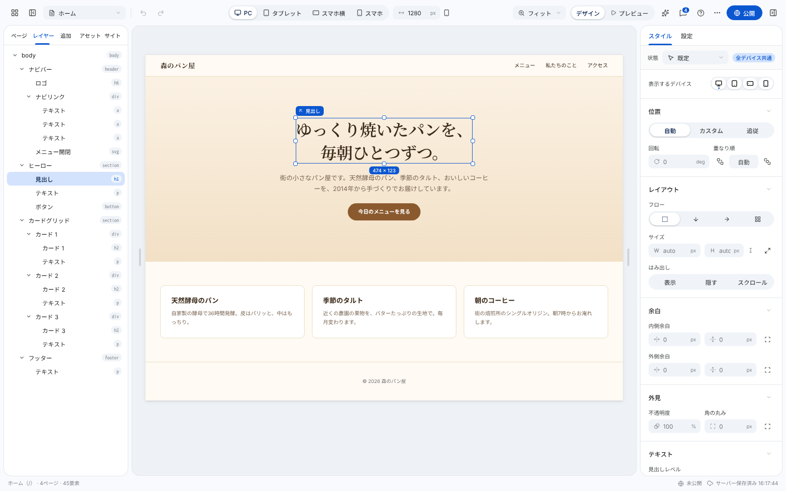
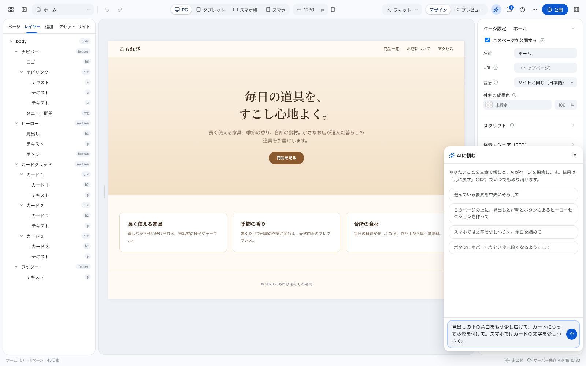
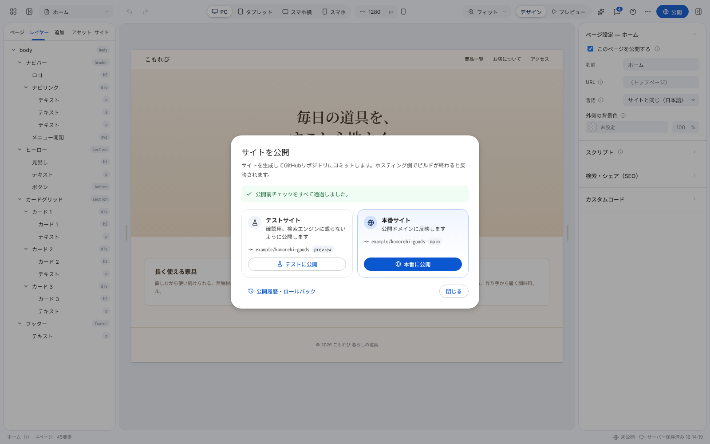
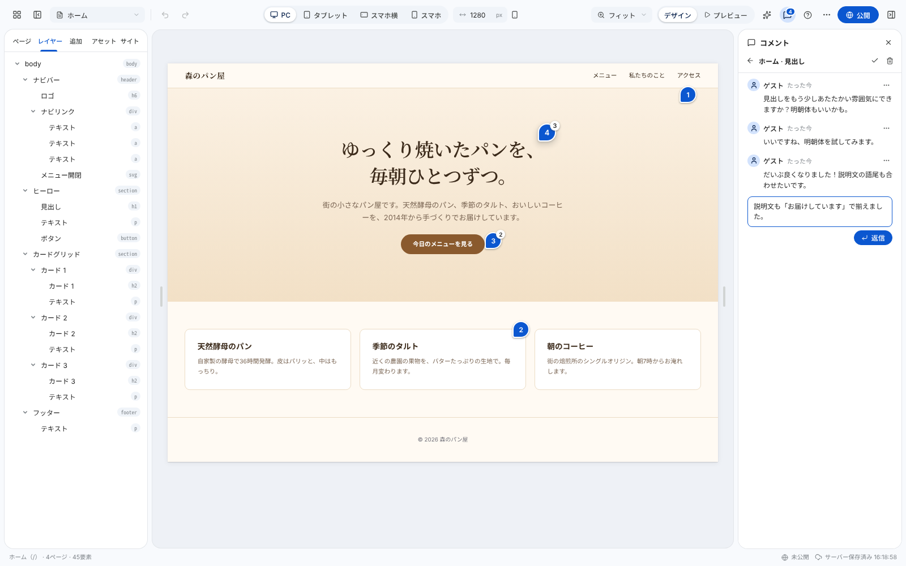
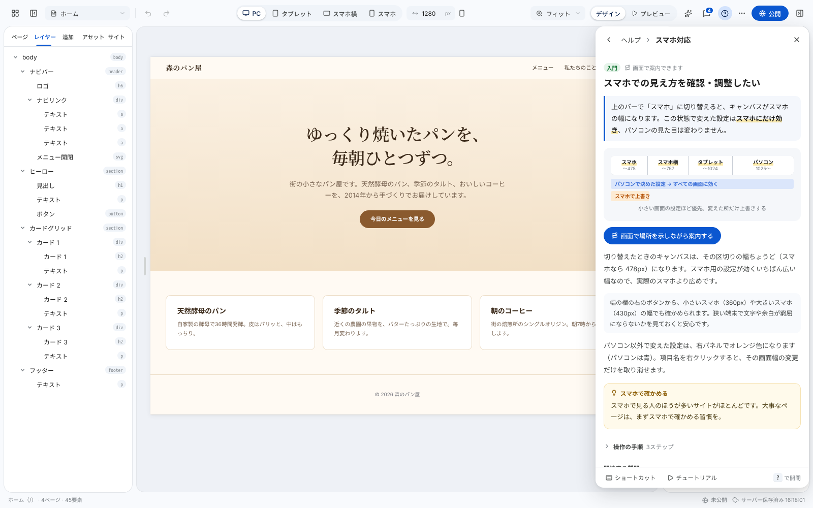
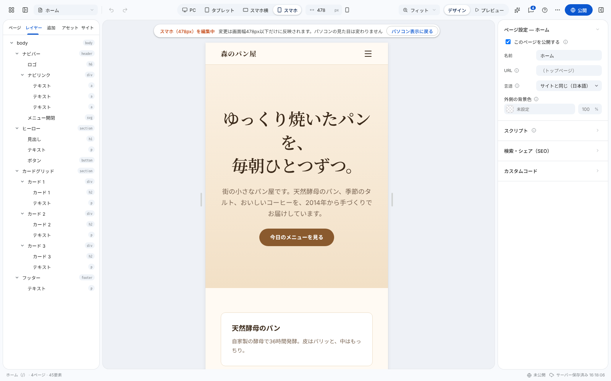
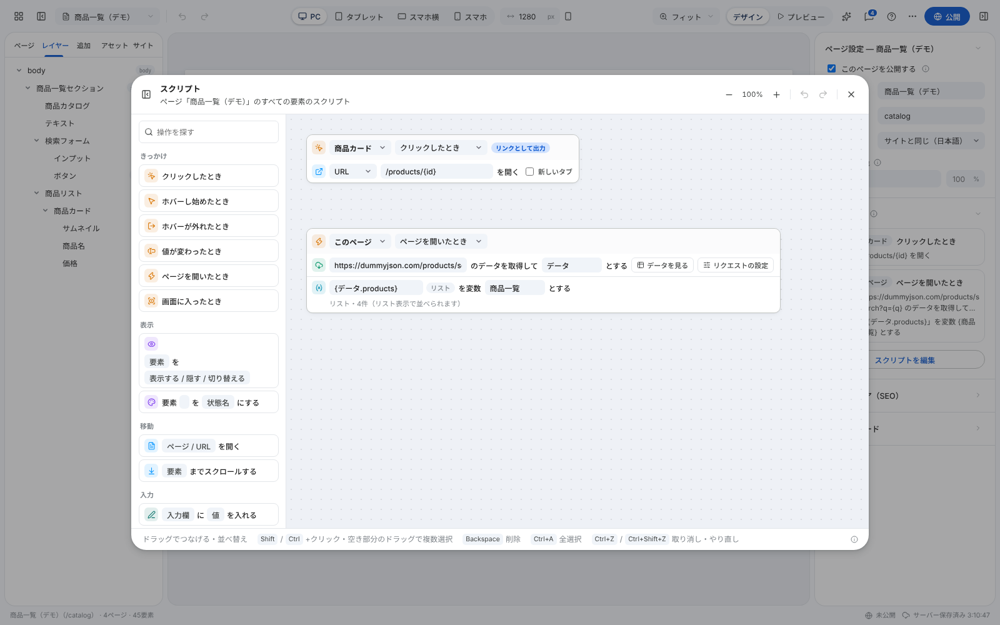

<h1 align="center">Tsumu</h1>

<p align="center">
  <strong>Design freely. Build openly.</strong><br>
  ノーコードでWebサイトを作れる、オープンソースのエディタ。
</p>

<p align="center">
  <a href="LICENSE"></a>
  
  
  
  
  
  <a href="CONTRIBUTING.ja.md"></a>
</p>

<p align="center">
  
</p>

Tsumu は、キャンバス上でウェブサイトを制作し、標準的なプロジェクトとして書き出し・公開できるエディタです。公開したサイトは **Tsumu に依存せず**、任意の環境でホスティングやコードの編集ができます。

## 特徴

- **ビジュアル編集**：Flexbox・Grid、画面幅ごとのスタイル、ホバーや独自の状態、アニメーション、再利用できるコンポーネントに対応。
- **ノーコードのスクリプト**：「きっかけ → 動作」のブロックを組み合わせ、クリック・入力・表示切り替え・条件分岐・リスト操作などを設定。
- **外部データ連携**：API から JSON を取得してリスト表示し、`/news/[slug]` のような詳細ページを生成。
- **インポート**：Tsumu の ZIP・`doc.json` から復元でき、既存の HTML やウェブサイトの ZIP も編集可能な要素として取り込み。
- **選べる出力形式**：Next.js・React・Vue・Nuxt・SvelteKit・HTML・単一 HTML に対応。TypeScript・JavaScript、CSS・CSS Modules・Tailwind CSS も選択可能。
- **GitHub への公開**：生成したコードをサイトごとのリポジトリに push。本番・テスト用ブランチを分けられ、手動で追加したファイルも保持。
- **公開前チェックと復元**：リンク切れ、画像の代替テキスト、見出し順序、スマートフォンでの表示崩れを検出。公開履歴からのロールバックにも対応。
- **リアルタイム共同編集**：複数人の編集を要素のプロパティ単位でマージ。キャンバスへのコメントや編集・公開履歴も利用可能。
- **AI による編集（任意）**：文章で指示してページを編集。Claude・Gemini・OpenAI などに対応。
- **複数サイトの管理**：サイトごとに編集データと公開先を分離し、ページや要素を別のサイトへコピー可能。
- **セルフホスト**：Cloudflare Workers・Node.js・Docker で動作。外部サービスは必要な機能に応じて設定。
- **ヘルプと多言語 UI**：チュートリアル、図解付き Q&A、画面上のガイドを内蔵。日本語・英語に対応。

## スクリーンショット

<table>
  <tr>
    <td width="50%"><br><sub><b>AIに頼む</b></sub></td>
    <td width="50%"><br><sub><b>公開</b>: GitHubにpush</sub></td>
  </tr>
  <tr>
    <td width="50%"><br><sub><b>コメント</b></sub></td>
    <td width="50%"><br><sub><b>ヘルプ内蔵</b></sub></td>
  </tr>
  <tr>
    <td width="50%"><br><sub><b>画面幅ごとの編集</b></sub></td>
    <td width="50%"><br><sub><b>ノーコードのスクリプト</b></sub></td>
  </tr>
</table>

## ローカルで起動

**Node.js 26.12.1 以上**、**npm 12.2.1 以上**が必要です。

```bash
git clone https://github.com/abshrimp/tsumu.git
cd tsumu
npm ci
npm run dev
```

[http://localhost:3000](http://localhost:3000) にアクセスしてサイトを作成します。ローカル開発では API キーやログイン設定は不要です。

## 公開とデプロイ

Tsumuから公開（push）するには GitHub リポジトリを作成し、**Contents: Read and write** 権限を持つ fine-grained トークンを `GITHUB_TOKEN` に設定して、サイトの設定から公開先を選択します。ZIP の書き出しにはトークンは不要です。

エディタは **Cloudflare Workers**・**Node.js**・**Docker** で動作します。サーバーに保存するには、Cloudflare では D1・Durable Objects・KV、Node.js・Docker では `TSUMU_DATA_DIR` を設定します。サーバーの保存先がない場合、編集データはブラウザ内だけに保存されます。

> [!IMPORTANT]
> インターネットに公開する場合は Google ログインを設定してください。`npm run dev` はログインを省略し、`ALLOW_ANONYMOUS=true` の場合も URL を知っている人なら誰でも編集・公開できます。匿名アクセスはローカル環境か隔離されたデモに限って使用してください。

デプロイ手順、認証、出力形式、環境変数、バックアップ、制限事項は[詳細ガイド](docs/user-guide.ja.md)を参照してください。

## ドキュメント

- [詳細ガイド](docs/user-guide.ja.md) · [English](docs/user-guide.md)
- [設計](ARCHITECTURE.ja.md) · [環境変数](.env.example)
- [コントリビュート](CONTRIBUTING.ja.md) · [セキュリティ](SECURITY.md) · [行動規範](CODE_OF_CONDUCT.md)

## ライセンス

[MIT](LICENSE) © abshrimp
