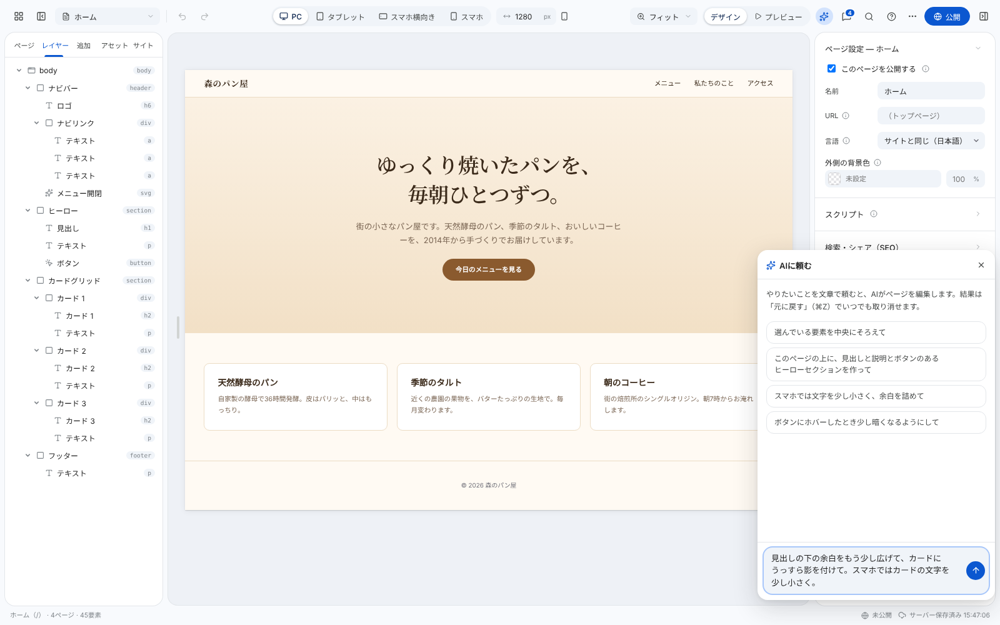
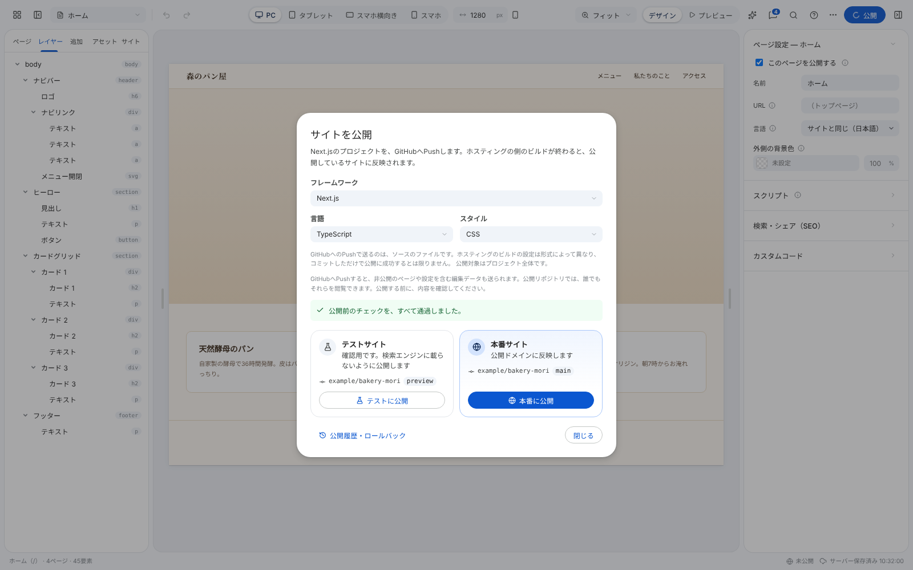
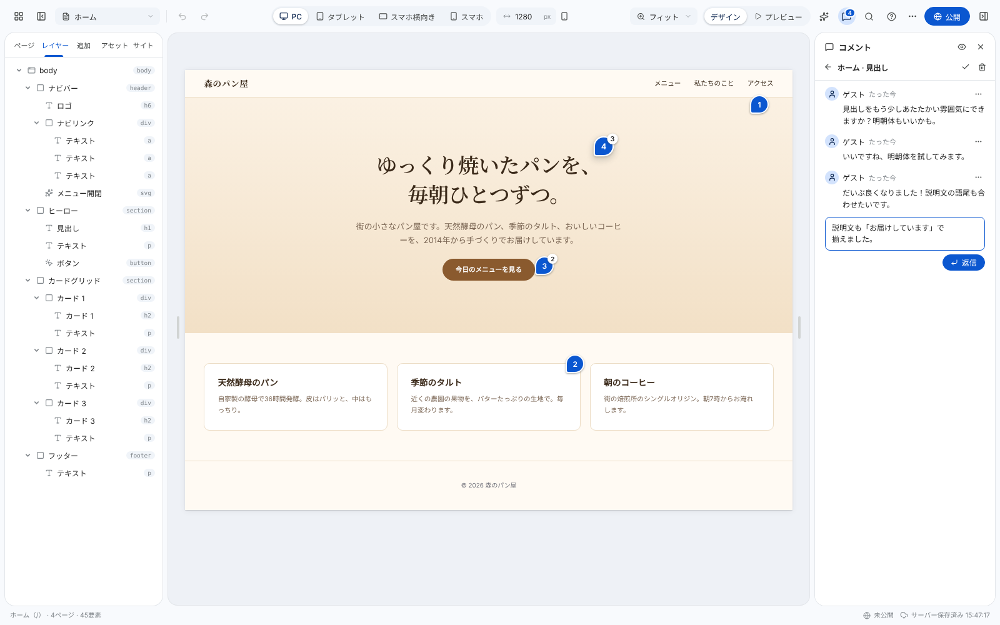
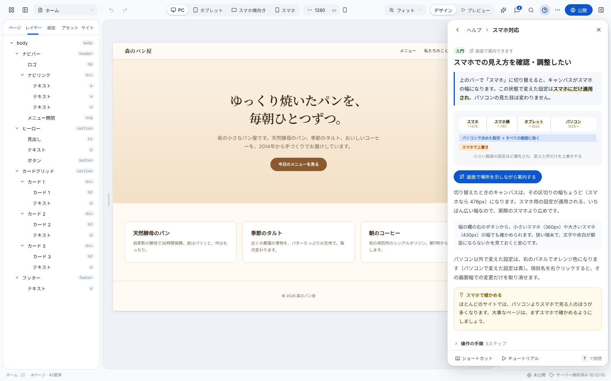
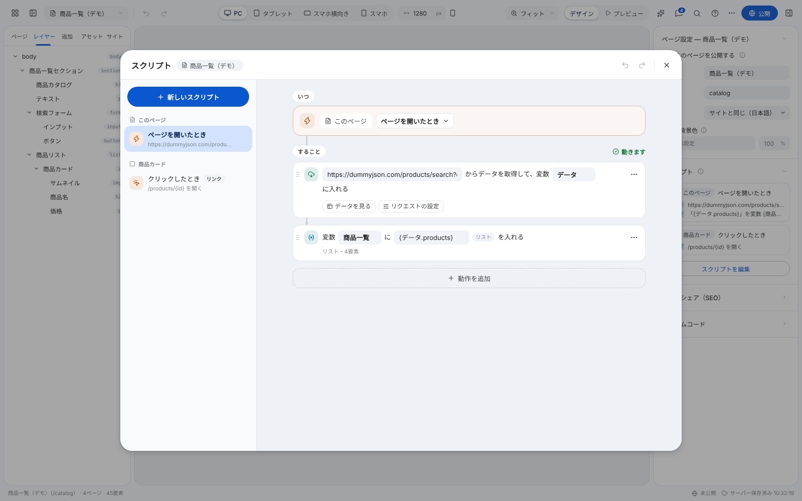

<h1 align="center">Tsumu</h1>

<p align="center">
  <strong>Design freely. Build openly.</strong><br>
  オープンソースのノーコードWebサイトエディタ
</p>

<p align="center">
  <a href="LICENSE"></a>
  
  
  
  
  
  <a href="CONTRIBUTING.ja.md"></a>
</p>

<p align="center">
  <a href="https://tsumu.ebii.net"><strong>デモを試す</strong></a> · <a href="README.md">English</a> · 日本語
</p>

<p align="center">
  
</p>

Tsumu を使うと、ドラッグなどの直感的な操作だけで Web サイトを作成できます。標準的なプロジェクトとして書き出し・公開できるため、**Tsumu に依存せず** 任意の環境でホスティングやコードの編集ができます。

## 特徴

- **ビジュアル編集**：Web の知識ゼロで、スタイル、ホバーなどでの状態変化、アニメーションまで編集できます。
- **ノーコードのスクリプト**：「いつ」と「すること」を上から順に並べるだけで、JavaScript のコードが構築できます。
- **外部データ連携**：API から JSON を取得して利用できます。
- **インポートとバックアップ**：Tsumu のプロジェクト ZIP をホーム画面にドロップすると、デザインと同梱のアセットを復元できます。「履歴・ロールバック」からの完全なバックアップ ZIP の書き出し・復元、`doc.json` の読み込み、HTML ファイルや Web サイトの ZIP から編集可能なページへの変換にも対応しています。 Tsumu MCP が生成した一時リンクからは、新しい編集可能なサイトを直接作成できます。正常に保存できた後、一時データは MCP サーバーから削除されます。
- **選べる出力形式**：Next.js・React・Vue・Nuxt・SvelteKit・静的 HTML のプロジェクトを ZIP で書き出せます。1ページを1ファイルで共有するには「単一のHTML」を選びます。
- **選べる公開先**：サーバーの環境変数で GitHub・Netlify・Cloudflare Pages を切り替え、公開ボタンからデプロイできます。
- **リアルタイム共同編集とサイト権限**：複数人での同時編集やコメントに加え、サイトごとに **オーナー**・**編集者**・**閲覧のみ** の権限を設定できます。
- **AI による編集（任意）**：内蔵の「AIに頼む」で文章からページを編集できるほか、外部の AI クライアントを MCP（`tsumu-mcp`）で接続して編集することもできます。
- **セルフホスト**：Cloudflare Workers・Node.js・Docker で動作します。
- **ヘルプと多言語 UI**：チュートリアル、図解付き Q&A、画面上のガイドを内蔵しています。

## スクリーンショット

<table>
  <tr>
    <td width="50%"><br><sub><b>AIに頼む</b></sub></td>
    <td width="50%"><br><sub><b>公開</b>: GitHubにpush</sub></td>
  </tr>
  <tr>
    <td width="50%"><br><sub><b>コメント</b></sub></td>
    <td width="50%"><br><sub><b>ヘルプ内蔵</b></sub></td>
  </tr>
  <tr>
    <td width="50%"><br><sub><b>画面幅ごとの編集</b></sub></td>
    <td width="50%"><br><sub><b>ノーコードのスクリプト</b></sub></td>
  </tr>
</table>

## ローカルで起動

**Node.js 26.12.1 以上**、**npm 12.2.1 以上**が必要です。

```bash
git clone https://github.com/abshrimp/tsumu.git
cd tsumu
npm ci
npm run dev
```

[http://localhost:3000](http://localhost:3000) にアクセスしてサイトを作成します。ローカル開発では API キーやログイン設定は不要です。

アセットを含めて再編集できる形で保存するには、**⋯ → zipでエクスポート** で **プロジェクト全体** を選び、ZIP をダウンロードします。ページやコンポーネントだけを取り出す手順は[出力形式](docs/user-guide.ja.md#出力形式)を参照してください。

## 公開とデプロイ

サーバーの `PUBLISH_PROVIDER` に `github`（既定）・`netlify`・`cloudflare` のいずれかを設定します。

- **GitHub**：公開用リポジトリを作成し、**Contents: Read and write** 権限を持つ `GITHUB_TOKEN` を設定します。サイト設定から公開先を選びます。生成コードと編集用データをpushします。
- **Netlify**：`NETLIFY_OAUTH_CLIENT_ID`・`NETLIFY_OAUTH_REDIRECT_URI`・`NETLIFY_TOKEN_ENCRYPTION_KEY` を設定します。各サイトの所有者が初めて**公開**を押すと、**自身のNetlifyアカウントでログイン**する画面に進みます。認証後はTsumuの公開画面に戻り、チームが1つなら自動選択、複数なら公開画面で選択します。サーバー共通のNetlifyトークンは使用しません。
- **Cloudflare Pages**：`CLOUDFLARE_ACCOUNT_ID` と `CLOUDFLARE_API_TOKEN` を設定します。

Netlify・Cloudflare Pagesでは、生成した静的HTML・CSS・JavaScript・アセットだけをアップロードします。サーバーへのサイト保存が必要です。複数ユーザー向けの公開サービスでは、Googleログインを設定したうえで `ALLOW_PUBLIC_SIGNUP=true` を指定すると、Googleで本人確認された利用者が**他人のサイトにアクセスせず、自分のサイト**を作成できます。

静的ホスティングでもテスト公開が利用できます。独自ドメインは公開サービスで設定し、必要に応じてサイト設定にURLを入力します。公開用トークンがなくてもZIP書き出しは可能です。

編集データをサーバーに保存するには、**Cloudflare Workers** では D1・Durable Objects・KV を設定し、**Node.js** では `TSUMU_DATA_DIR` に保存先を指定します。**Docker** では `/data` にボリュームをマウントします。ブラウザ保存の場合、編集データは作成したブラウザ内に保存されます。アセットを削除したときの扱いは[保存先によって異なります](docs/user-guide.ja.md#エディタのデプロイ)。

> [!IMPORTANT]
> エディタをインターネットに公開する前に、[Google ログイン](docs/user-guide.ja.md#googleログイン)を設定してください。ログイン未設定の `npm run dev` は、既定で `localhost` などのループバック宛ての匿名アクセスを受け付けます。`ALLOW_ANONYMOUS=true` を設定すると他のホスト名からも開けます。その場合、アクセスできる人は誰でも編集でき、公開サービスの認証情報が設定されていれば公開もできます。

デプロイ手順、認証、出力形式、環境変数、バックアップ、制限事項は[詳細ガイド](docs/user-guide.ja.md)を参照してください。

## ドキュメント

- [詳細ガイド](docs/user-guide.ja.md) · [English](docs/user-guide.md)
- [設計](ARCHITECTURE.ja.md) · [環境変数](.env.example)
- [コントリビュート](CONTRIBUTING.ja.md) · [セキュリティ](SECURITY.ja.md) · [行動規範](CODE_OF_CONDUCT.md)（英語）

## ライセンス

[MIT](LICENSE) © abshrimp
