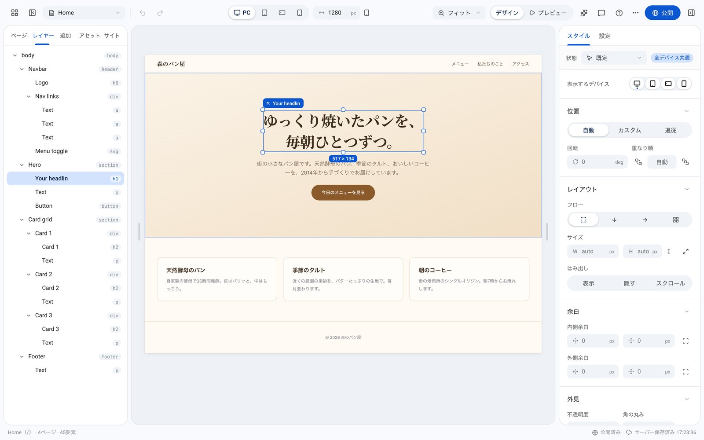
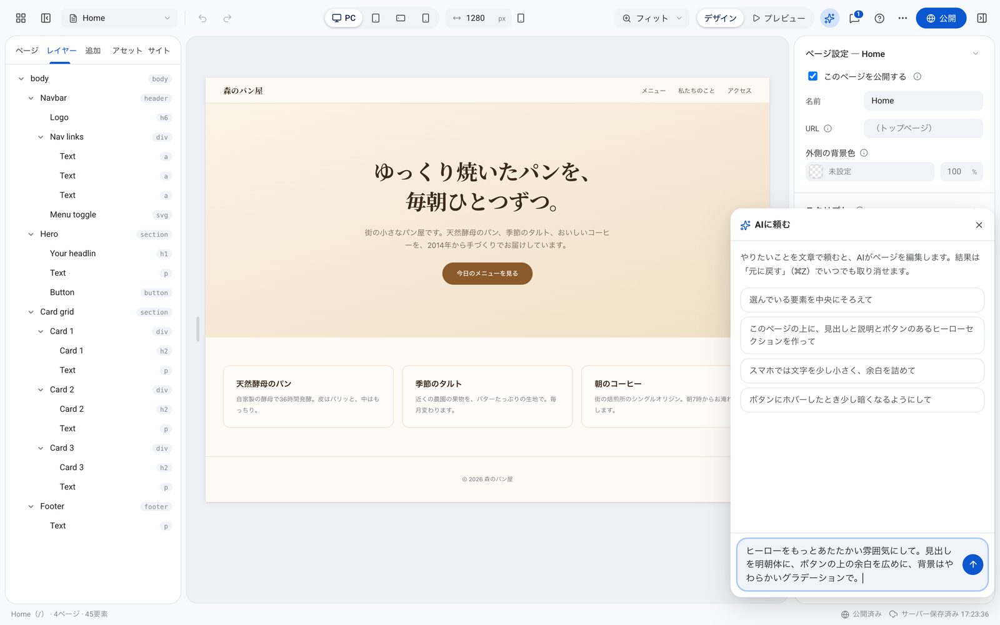
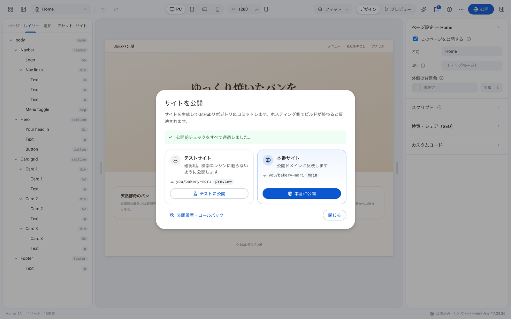
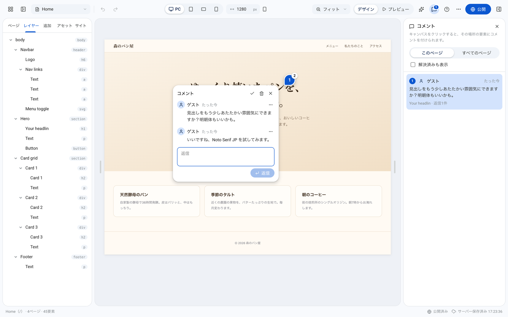
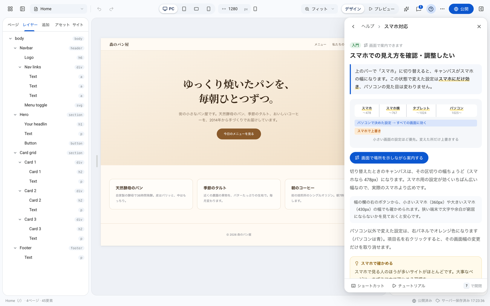
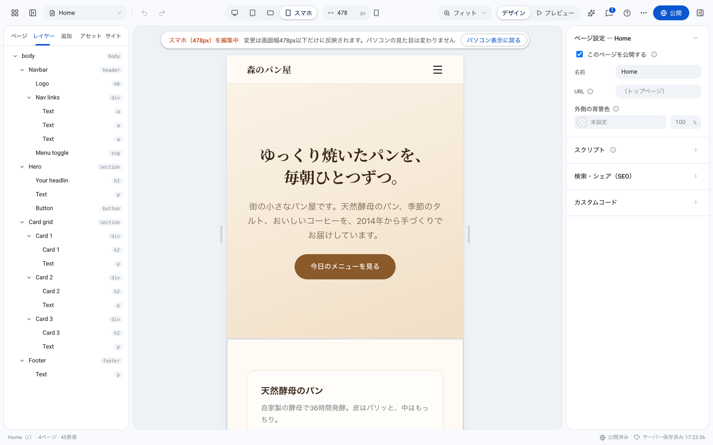
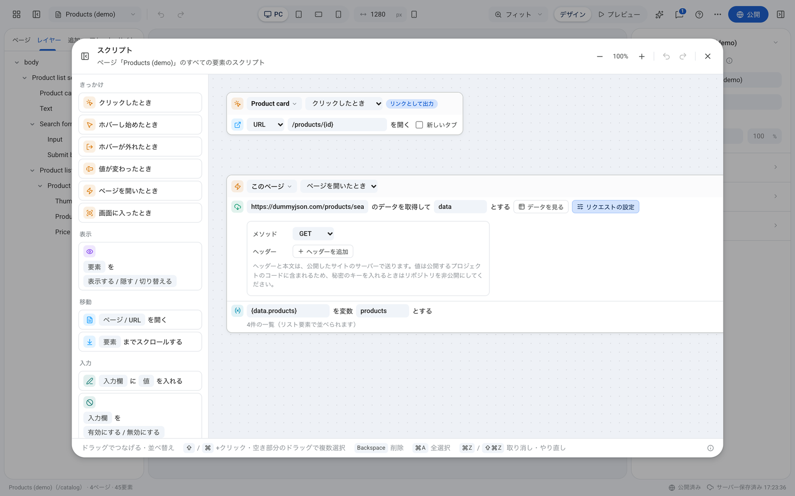

<h1 align="center">Tsumu</h1>

<p align="center">
  <strong>Design freely. Build openly.</strong><br>
  An open-source visual website builder.
</p>

<p align="center">
  <a href="LICENSE"></a>
  
  
  
  
  
  <a href="#コントリビュート"></a>
</p>

<p align="center">
  <a href="https://tsumu.ebii.net"><strong>デモを試す</strong></a> · <a href="README.md">English</a> · 日本語
</p>

<p align="center">
  
</p>

Tsumu は、キャンバス上でページを組み立てて、**通常の Next.js プロジェクト**として GitHub リポジトリに公開するビジュアルエディタです。書き出したサイトは Tsumu に依存しないため、ロックインはありません。Vercel・Netlify・Cloudflare Workers・Node.js など任意の環境で動作します。サイトのリポジトリに手で追加したファイル（APIルート・コンポーネント・設定など）は次の公開でもそのまま残るため、エディタとコードを併用できます。

1つのエディタで複数のサイトを管理できます。サイトごとに編集データと公開先のリポジトリを持ち、ホーム画面から作成・複製・切り替えを行います。

## 特徴

- **自分のものになるコード**: 公開したサイトは読める普通の Next.js で、依存するのは `next`・`react`・`react-dom` だけ
- **ビジュアル編集**: フレックスボックス・グリッドのレイアウト、画面幅ごとのスタイル、ホバーなどの状態、モーション、コンポーネント、リスト
- **コードを書かないスクリプト**: 「きっかけ → 動作」のブロックで、クリック・メニュー開閉・スクロール・入力・絞り込み・並べ替え・保存
- **外部データ**: 任意のAPIからJSONを取得してリストに表示し、1件ごとの詳細ページ（`/news/[slug]`）を生成
- **同時編集**: 複数人での同時編集に対応し、要素の項目単位でマージ。キャンバスにコメントを付けたり、誰が編集・公開したかを確認したりできる
- **GitHub経由の公開**: 生成したプロジェクトをボタン1つでコミット。テスト公開は、検索エンジンに載らないプレビュー用ブランチへ
- **公開前チェック**: リンク切れ・画像の代替テキスト漏れ・見出しの順序・スマホで小さすぎる文字・スマホではみ出すレイアウトを、公開する前に見つける
- **履歴とロールバック**: 公開サイトを過去の任意の版へ戻せる。編集内容も、公開した版やサーバーの日次バックアップから復元可能
- **AIに頼む（任意）**: 文章で指示するとAIがページを編集。1回の「元に戻す」で取り消し可能。Claude・Gemini・OpenAI・OpenAI互換APIに対応
- **ヘルプ内蔵**: チュートリアル、目的から探せるQ&A・図解、画面上の位置を示す操作ガイド
- **複数のサイト**: サイトの作成・複製・削除。要素やページを丸ごとほかのサイトへコピー（使用中の画像・コンポーネントも一緒に移行）
- **好きな場所で動かせる**: エディタは Cloudflare Workers（無料プランで可）・Node.js・Docker のどれでも動き、どのサービスも任意
- **日本語・英語のUI**（ほかの言語も追加可能）

## スクリーンショット

<table>
  <tr>
    <td width="50%"><br><sub><b>AIに頼む</b></sub></td>
    <td width="50%"><br><sub><b>公開</b>: チェックのあと、テストサイトか本番へ</sub></td>
  </tr>
  <tr>
    <td width="50%"><br><sub><b>コメント</b></sub></td>
    <td width="50%"><br><sub><b>ヘルプ内蔵</b></sub></td>
  </tr>
  <tr>
    <td width="50%"><br><sub><b>画面幅ごとの編集</b></sub></td>
    <td width="50%"><br><sub><b>コードを書かないスクリプト</b></sub></td>
  </tr>
</table>

## 構成

```
Tsumu（このリポジトリ）
│  Cloudflare Workers ／ Node.js ／ Docker のどれかで動かす
│  ホーム（サイトの一覧）・エディタ /sites/<id>・Googleログイン（任意）
│
│  公開 → main ／ テスト公開 → preview
▼
サイトごとのリポジトリ（GitHub）
│  サイトA・サイトB・…（それぞれ main が本番、preview がテスト）
│
│  ブランチごとに自動でビルド
▼
ホスティング（自由に選べる）
   Vercel / Netlify / Cloudflare Workers / Node.js
```

- **エディタ**は Next.js のアプリで、Cloudflare Workers・Node.js・Docker のどれでも動きます（[エディタのデプロイ](#エディタのデプロイ)）。サイトの一覧・編集データ・コメント・編集と公開の記録・ログイン許可リストと、アップロードした画像・動画・音声（全サイト共通）は、動かす場所に合わせた保存先に置きます。
- **公開サイト**は、サイトごとのリポジトリにコミットされる通常の Next.js アプリです。エディタと同じ場所で動かす必要は**ありません**。
- **テスト公開**は、同じリポジトリの別のブランチ（既定は `preview`）にコミットします。Vercel・Cloudflare Workers Builds・Netlify は本番以外のブランチを自動でプレビューとしてビルドするため、ホスティングの設定は1つで足ります。テスト版は検索エンジンに登録されないよう書き出します（robots.txt・`noindex`・`X-Robots-Tag`・クローラーの拒否）。

## 環境設定

いずれも**任意**です。設定が欠けていても、エディタの起動と編集は可能です。

| 設定 | 無いとき | あるとき |
|---|---|---|
| サーバーの保存先（Cloudflare は D1・KV、Node.js・Docker は `TSUMU_DATA_DIR`） | サイトの一覧・編集データ・コメント・画像などをブラウザ内に保存（そのブラウザでのみ参照可能。画像は1ファイル2MBまで） | サーバーに保存。別の端末・複数人での編集やコメントが可能になり、日次バックアップと、編集・公開した人の記録が残る（画像は1ファイル25MBまで） |
| Googleログイン（`AUTH_*`） | 開けない（設定を案内する画面を表示）。`ALLOW_ANONYMOUS=true` のときと `npm run dev` ではログインなしで開ける（**URLを知っていれば誰でも編集・公開できる**） | 許可したGoogleアカウントのみ利用可能 |
| `GITHUB_TOKEN` | 公開できない旨を表示（zipでの書き出しは可能） | サイトの設定で指定したリポジトリへ公開可能 |
| `AI_*` | 「AIに頼む」を表示しない | 「AIに頼む」を利用可能 |

インターネットに公開するエディタでは、必ずGoogleログインを設定してください。ログインなしで動かすのは、手元だけで使うときや、公開先（`GITHUB_TOKEN`）を設定しないデモに限ってください。

## ローカルで起動

Node.js 26.12.1 以上と npm 12.2.1 以上が必要です。nvmを使う場合は、クローン後に `nvm use` を実行してください。

```bash
git clone https://github.com/abshrimp/tsumu.git
cd tsumu
npm ci
npm run dev
```

http://localhost:3000 を開くと、ホーム画面（サイトの一覧）が表示されます。「新しいサイト」で作成すると、`/sites/<id>` のエディタが開きます。

`npm run dev` では、`wrangler.jsonc` をもとに Cloudflare の D1・KV がローカルで再現されます（データは `.wrangler/state` に保存。`TSUMU_DATA_DIR` より優先）。環境変数がなくても動作し、ログインは省略されます（`npm run dev` のときだけ。`npm run preview` でログインなしにするには、`.dev.vars` に `ALLOW_ANONYMOUS=true` を書きます）。同時編集の反映はポーリングになるため、WebSocket での動作を確認するときは `npm run preview` を使います。

## エディタのデプロイ

エディタは次の3つのどれでも動きます。機能は同じで、違うのは保存先と、ほかの人の編集が届く仕組みです。

| | Cloudflare Workers | Node.js | Docker |
|---|---|---|---|
| 保存先 | D1（データベース）・Workers KV（画像など） | `TSUMU_DATA_DIR` のフォルダ（SQLite・ファイル） | コンテナの `/data`（ボリュームにつなぐ） |
| ほかの人の編集の反映 | すぐ（WebSocket・Durable Object） | すぐ（Server-Sent Events） | すぐ（Server-Sent Events） |
| 費用 | 無料プランで動く（[制限事項](#制限事項)） | サーバー代 | サーバー代 |
| 向いている場合 | サーバーを持たずに動かしたい | 手元や既存のサーバーで動かしたい | コンテナで管理したい |

どの場合も、テーブルは初回アクセス時に自動で作成されます（マイグレーション不要）。保存先を用意しなければ、データはブラウザ内に保存されます（[環境設定](#環境設定)）。

### 共通の準備

#### Googleログイン

1. [Google Cloud Console](https://console.cloud.google.com/apis/credentials) で OAuth クライアントID（ウェブアプリケーション）を作成
2. 承認済みのリダイレクトURIを追加
   - `https://<エディタのドメイン>/api/auth/callback/google`
   - `http://localhost:3000/api/auth/callback/google`（ローカルでもログインを試す場合）
3. OAuth同意画面はテストモードのままで問題ありません（自分をテストユーザーに追加）

`AUTH_SECRET`・`AUTH_GOOGLE_ID`・`AUTH_GOOGLE_SECRET` の3つが揃うとログインが有効になります。`AUTH_URL` にはエディタのURLを設定します。`ALLOWED_EMAILS` に記載したアカウントは常にログインでき、それ以外のアカウントはホーム画面の **設定 → ログインできるアカウント** で追加します（サーバーの保存先が必要）。

#### GitHubのトークン

**Fine-grained personal access token** を作成し、公開に使うすべてのリポジトリに **Contents: Read and write** を付与します。トークンは全サイト共通です。サイトを追加したら、トークンの対象リポジトリにも追加してください（対象を「All repositories」にしておけば追加は不要です）。

公開先のリポジトリはサイトごとに、ホーム画面の **サイトの「…」→ 設定** で指定します（[サイトの公開先](#サイトの公開先)）。

### Cloudflare Workers

**1. 保存先を作る（任意）**

```bash
npx wrangler login
cp wrangler.jsonc wrangler.local.jsonc
npx wrangler d1 create tsumu                  # 表示された database_id を wrangler.local.jsonc に設定
npx wrangler kv namespace create ASSETS_KV    # 表示された id を wrangler.local.jsonc に設定
```

`wrangler.local.jsonc` はGitの管理対象外のため、IDがリポジトリに含まれることはありません。`npm run dev`・`npm run preview`・`npm run deploy` は、このファイル（または環境変数 `WRANGLER_CONFIG` で指定したファイル）があれば自動で使用します。IDが未設定のバインディングはデプロイ時に除外されるため、片方だけ作成しても、どちらも作成しなくてもデプロイできます。

**2. シークレットを設定してデプロイ**

各変数を `npx wrangler secret put <名前>` で設定してから（[環境変数](#環境変数)。`wrangler.local.jsonc` を使う場合は `--config wrangler.local.jsonc` を付ける）、デプロイします。

```bash
npm run deploy
```

push のたびに Cloudflare Workers Builds で自動デプロイする場合は、リポジトリを接続して次のとおり設定します。

- Build command: `node scripts/cloudflare.mjs build`
- Deploy command: `node scripts/cloudflare.mjs deploy`
- Non-production branch deploy command: `node scripts/cloudflare.mjs upload`
- ビルド変数（Settings → Build → Variables and secrets。任意）: `D1_DATABASE_ID`・`KV_NAMESPACE_ID`

ビルド時にスクリプトが `wrangler.jsonc` からデプロイ用の設定（`wrangler.generated.jsonc`）を生成し、ビルド変数のIDを埋め込みます。IDのないバインディングは除外されるため、IDをコミットする必要はありません。

### Node.js

Node.js 26.12.1 以上と npm 12.2.1 以上が必要です。nvmを使う場合は、クローン後に `nvm use` を実行してください。環境変数 `TSUMU_DATA_DIR` にフォルダを指定すると、`<フォルダ>/tsumu.db`（SQLite）にデータを、`<フォルダ>/assets/` に画像などを保存します。組み込みの `node:sqlite` を使うため、追加のパッケージは要りません。

```bash
npm ci
npm run build
TSUMU_DATA_DIR=./data npm start
```

ログインを設定せずに手元で試すときは、`ALLOW_ANONYMOUS=true TSUMU_DATA_DIR=./data npm start` のように `ALLOW_ANONYMOUS=true` を付けます。

ほかの環境変数は `.env.local` か、サーバーの環境変数で設定します（[環境変数](#環境変数)）。ポートは `PORT`（既定 3000）で変えられます。

- バックアップは `TSUMU_DATA_DIR` のフォルダを丸ごとコピーします。SQLite は書き込み中の内容を `tsumu.db-wal` にも持つため、`tsumu.db`・`tsumu.db-wal`・`tsumu.db-shm` をまとめて、できればエディタを止めてからコピーしてください。
- nginx などのリバースプロキシの後ろで動かす場合は、`AUTH_URL` に外から開くURLを設定し、プロキシで `X-Forwarded-Host` と `X-Forwarded-Proto` を転送してください（Googleログインの戻り先が正しくなります）。
- 同じ `TSUMU_DATA_DIR` を使うエディタは1つだけ起動してください（ほかの人の編集の通知は、1つのプロセスの中で配ります）。
- リバースプロキシでは、`/api/collab/events` の応答をためずに流すようにしてください（nginx は応答の `X-Accel-Buffering: no` で自動的にそうなります）。

### Docker

イメージには Node.js 版のエディタが入っていて、データはコンテナの `/data` に保存します。

```bash
docker build -t tsumu .
docker run -d --name tsumu -p 3000:3000 -v tsumu-data:/data --env-file .env.local tsumu
```

ログインを設定せずに手元で試すときは、`-e ALLOW_ANONYMOUS=true` を付けます。

環境変数は `--env-file`（または `-e`）で渡します（[環境変数](#環境変数)）。渡すファイルに `TSUMU_DATA_DIR` は書かないでください（ボリュームの外に保存されてしまいます）。

**データの保存場所**

```
/data/
  tsumu.db, tsumu.db-wal, tsumu.db-shm   サイトの一覧・編集データ・コメント・バックアップなど（SQLite）
  assets/data/                            アップロードした画像・動画などの本体
  assets/meta/                            各ファイルの種類（Content-Type）
```

- `-v tsumu-data:/data` は、Docker の名前付きボリューム `tsumu-data` に保存します。コンテナを作り直しても、同じボリュームを指定すればデータは残ります。
- 手元のフォルダに置く場合は `-v "$(pwd)/data:/data"` とします。コンテナは `node` ユーザー（UID 1000）で動くため、Linux ではフォルダの所有者を合わせてください（`sudo chown 1000:1000 data`）。
- **`-v` を付けずに起動しないでください。** 名前のないボリュームに保存され、コンテナを作り直すと前のデータが見えなくなります。

名前付きボリュームのバックアップ（コンテナを止めてから実行すると確実です）:

```bash
docker stop tsumu
docker run --rm -v tsumu-data:/data -v "$(pwd)":/backup busybox tar czf /backup/tsumu-data.tgz -C /data .
docker start tsumu
```

リバースプロキシの後ろで動かす場合の設定は、[Node.js](#nodejs) と同じです。

## サイトの公開先

ホーム画面の **サイトの「…」→ 設定** で、サイトごとに次の項目を指定します。サイトの作成時でも、作成後でも指定できます。

| 項目 | 内容 |
|---|---|
| GitHubリポジトリ | `owner/name`。未指定でも編集は可能（公開は不可） |
| 本番のブランチ | 既定 `main` |
| テスト公開のブランチ | 既定 `preview`。空欄にするとテスト公開を無効化 |
| 本番サイトのURL・テストサイトのURL | 任意。公開画面から各サイトを開ける |

公開先のリポジトリはあらかじめ作成しておきます（空のリポジトリでも、README付きで初期化したものでも構いません）。

## 公開サイトのホスティング

初回の公開後、サイトのリポジトリをホスティングサービスに接続します。

| ホスティング | 設定 | テスト公開 |
|---|---|---|
| **Vercel** | リポジトリをインポート | 本番以外のブランチに自動でプレビューURLが付く |
| **Netlify** | リポジトリをインポート | Branch deploys を有効にする |
| **Cloudflare Workers Builds** | Build: `npx opennextjs-cloudflare build`<br>Deploy: `npx opennextjs-cloudflare deploy` | Non-production branch deploy command を `npx opennextjs-cloudflare upload` に設定（プレビューURLを有効化） |
| **Node.js** | `npm install && npm run build && npm start` | テスト公開のブランチを別途ビルド |

### データの更新間隔と Cloudflare

外部のJSONを使うページは、エディタの **サイト** タブで設定する **データの更新間隔** ごとに再生成されます。

- **標準**（Vercel・Netlify・Node.js）では Next.js の ISR により、生成済みのページをバックグラウンドで再生成します。
- **Cloudflare Workers** で ISR を動かすには、追加のキャッシュ（R2）とキューの設定が必要です。設定がない場合、生成済みのページは**再生成されません**。エディタの **サイト** タブで **公開先のホスティング → Cloudflare Workers** を選ぶと、該当ページをリクエストごとに描画し、取得したJSONを更新間隔の間だけ Cloudflare のキャッシュに保持する形で書き出します。

更新間隔を `0` にすると、どのホスティングでもリクエストごとに取得します。

### ロールバック

**公開 → 公開履歴・ロールバック**（または **⋯ → 履歴**）に、ブランチごとのコミットが一覧表示されます。

- **サイトを戻す**: 選んだ版のファイルを、ブランチの先端に新しいコミットとして積み直します。履歴は消えないため、ロールバック自体も後から取り消せます。
- **編集内容を復元**: 公開時に一緒に保存した編集データ（`_tsumu/doc.json`）をエディタに読み込みます。通常の編集として扱うため、⌘Z で元に戻せます。

同じ画面には、サーバーが保存する編集データの日次バックアップ（曜日ごとに7日分）も表示されます。

## AIに頼む（任意）

`AI_ENABLED=true` とAPIキーを設定すると、**AIに頼む** ボタンが表示されます。リクエストはエディタのサーバーの `/api/ai` を経由するため、APIキーがブラウザに渡ることはありません。

しくみ: ブラウザが編集中のページの要約（要素の階層・テキスト・スタイル。ほかのページは名前のみ）を送り、サーバーがエディタのデータ構造の説明と `edit_site` ツールを添えてAIに渡します。AIは編集操作（スタイルの変更・要素の追加や移動・テキストの変更など）を返し、サーバーはそれをページの複製に試験的に適用して、誤りがあればAIに修正させます。正しく適用できた操作だけをブラウザに返し、1回で取り消せる変更として適用します。スクリプト・データの設定・アセットは対象外です。

| `AI_PROVIDER` | APIキー | `AI_MODEL` の既定 | 備考 |
|---|---|---|---|
| `anthropic`（既定） | `ANTHROPIC_API_KEY` | `claude-opus-5-5` | `claude-sonnet-5-5`・`claude-haiku-5-5` を指定すると費用を抑えられる |
| `gemini` | `GEMINI_API_KEY` | `gemini-3.8-flash` | Gemini の OpenAI 互換APIを使用。最も安価なのは `gemini-2.5-flash-lite`。無料枠あり |
| `openai` | `OPENAI_API_KEY` | `AI_MODEL` を指定 | |
| `openai-compatible` | `AI_API_KEY` | `AI_MODEL` を指定 | ツール呼び出しに対応した Chat Completions API（OpenRouter・Ollama など）。`AI_BASE_URL` を指定 |

`AI_API_KEY` はどのプロバイダでも使用できます。`AI_EFFORT`（`low` 〜 `max`、既定 `medium`）で推論の量を調整でき、低いほど費用を抑えられます。小さいモデルほど操作の誤りが増えます（サーバーが検出して修正させるためページが壊れることはありませんが、やり取りの回数が増えます）。Gemini などの無料枠では、送信した内容がサービスの改善に利用される場合があります。

### Geminiで使う

エディタを動かす環境に次の値を設定します（ローカルと Node.js は `.env.local`、Docker は `--env-file`、Cloudflare は Worker の Variables and Secrets）。

```dotenv
AI_ENABLED=true
AI_PROVIDER=gemini
AI_MODEL=gemini-3.8-flash
GEMINI_API_KEY=your-api-key
```

APIキーはSecretとして保存します。`AI_API_KEY` はプロバイダ別のキーより優先されるため、プロバイダを切り替える際は古い共通キーが残っていないか確認してください。Claude・OpenAI・互換APIも、上の表の設定で切り替えられます。

ログインした状態で `/api/ai` を開くと、有効かどうかと使用するモデルを確認できます。`AI_ENABLED` を設定しているのに有効にならない場合は、不足している設定がサーバーのログに出力されます。設定を変更したら、ローカル・Node.js・Docker では再起動し、Cloudflare では変更を反映してください。

AIの操作は、適用前に作業用の複製で検証します。

- 通信の切断・時間切れ・修正されなかった操作エラー・生成の打ち切りが起きた場合は、変更を適用しません。
- 応答を待つ間に対象のページを編集した場合も、上書きを避けるため適用を中止します。
- 依頼はチャットの中止ボタンで取り消せます。適用した変更は、1回の「元に戻す」で取り消せます。
- チャットには、AIの作業の説明と、変更案の作成・検証・修正の進み具合、経過時間を表示します。完了後も「作業の記録」で確認できます。AIの内部の思考や署名は表示しません。

## 環境変数

すべて任意です（[環境設定](#環境設定)）。

| 変数 | 内容 |
|---|---|
| `AUTH_SECRET` | セッションの秘密鍵。`npx auth secret` で生成 |
| `ALLOW_ANONYMOUS` | `true` でログインなしでも開けるようにする（Googleログインを設定していないとき。`npm run dev` では不要）。URLを知っている人が誰でも編集・公開できるので、手元やデモだけで使う |
| `AUTH_URL` | 本番のエディタのURL（例: `https://tsumu.example.com`） |
| `AUTH_GOOGLE_ID` / `AUTH_GOOGLE_SECRET` | Google の OAuth クライアント |
| `ALLOWED_EMAILS` | 常にログインを許可するGoogleアカウント（カンマ区切り。画面からは削除不可）。追加分はホームの **設定** で管理 |
| `GITHUB_TOKEN` | 公開先のリポジトリすべてに Contents: Read and write を持つトークン（全サイト共通） |
| `AI_ENABLED` | `true` で「AIに頼む」を有効化 |
| `AI_PROVIDER` | `anthropic`（既定）・`gemini`・`openai`・`openai-compatible` |
| `AI_API_KEY` | APIキー（`ANTHROPIC_API_KEY`・`GEMINI_API_KEY`・`OPENAI_API_KEY` でも可） |
| `AI_MODEL` | モデルID。既定は `claude-opus-5-5`（anthropic）・`gemini-3.8-flash`（gemini） |
| `AI_BASE_URL` | `openai-compatible` のAPIのURL（例: `https://openrouter.ai/api/v1`） |
| `AI_EFFORT` | `low`・`medium`（既定）・`high`・`xhigh`・`max` |
| `TSUMU_DATA_DIR` | Node.js で動かすときの保存先のフォルダ（[Node.js](#nodejs)。Docker では `/data` に固定） |

ローカル開発と Node.js では `.env.local`、Docker では `--env-file` で渡すファイル、Cloudflare では `wrangler secret put` で設定します（[`.env.example`](.env.example) を参照）。

## 制限事項

### Cloudflare 無料枠（Cloudflare Workers で動かす場合）

| 項目 | 制限 | 影響 |
|---|---|---|
| Workers の CPU時間 | 1リクエスト10ms | アセットの多いサイトの公開で超える場合がある。Workers Paid（月$5、CPU 30秒）なら問題なし |
| D1 の値の大きさ | Cloudflare の文書では1つの値が2MBまで（実際にはそれより大きな値も入る） | Tsumu は編集データの大きさを制限しない。D1 が保存を拒んだときは、保存状態に「大きすぎる」と表示される |
| KV | 合計1GB・1ファイル25MB・書き込み1,000回/日 | 容量は全サイトで共有。アセットタブに全サイトの合計を表示 |
| KV の整合性 | 結果整合 | アップロード直後の反映に数秒かかる場合がある |
| GitHub API | 1時間5,000リクエスト | 公開1回で数回〜十数回 |

### サイト

- サイトを削除すると、編集データと自動バックアップも削除されます。公開済みのリポジトリと、保存先の画像は残ります。
- サイト間でコピーした画像は、同じファイルを共有します。ほかのサイトが使用しているファイルは、未使用として削除してもストレージからは削除されません。
- D1 がない場合、サイトはそのブラウザにのみ保存されるため、ブラウザのデータを削除すると失われます。

### 同時編集

- コメントは編集データとは別に保存します。公開サイトには含まれず、「元に戻す」の対象にもならず、編集・削除できるのは書いた本人だけです。
- 編集・公開した人は、人ごとに最後の時刻を記録します。Googleログインを使っていない場合は、全員が1人のゲストとして表示されます。
- マージは要素の項目単位です。別々の要素や、同じ要素の別々の項目（文字と色など）を同時に編集した場合は両方が残り、同じ項目を同時に編集した場合は後から保存した側が残ります。スクリプトの並びのような一覧は、まとめて1つの項目として扱います。
- 未保存の変更がある間や文字の入力中は、ほかの編集者の変更を入力の完了後に取り込みます。
- ほかの編集者の変更を取り込むと、元に戻す履歴もそれに合わせて再構成されます。
- 許可リストから外したアカウントは、既存のセッションでも次のAPIアクセスから拒否されます。接続済みの共同編集も、読み込み・保存・更新通知の送信前に許可を確認します。

### エディタと書き出し

- 公開は通常のコミットとして積み上げます。Tsumu が書き出したファイルはエディタの内容で上書きし、手で追加したファイルは残します（区別には `_tsumu/generated.json` を使います）。書き出したファイルを GitHub 上で直接編集していた場合は、上書きする前に確認します。書き出したファイルを手で変更し続けたい場合は、別のブランチで行ってください。
- 初回の公開でも既存ファイルを保持し、同じパスへの上書きは確認します。`_tsumu/` はTsumuの管理情報専用です。書き出したファイルの一覧が壊れている場合は公開を中止します。
- ページ専用のカスタムコードは `<head>` ではなくページの本文の先頭に入ります。
- キャンバスでは、カスタムコードとアイコンを無害化して表示します。中のスクリプトやイベント属性は公開したサイトでだけ動き、ログイン中のエディタの権限では動きません。
- `next/image` は、どのホスティングでも動作するよう `unoptimized` で書き出します。
- HTMLページ（HTMLを直接書いたページ）には、共通のレイアウト・メタデータ・カスタムコードは入りません。
- テキストをspanに分割した後は、span単位で編集します。
- ログインは Google アカウントのみに対応しています。

## 開発

設計の概要（`SiteDoc` のデータ構造、公開・同時編集・AIのしくみ）は [ARCHITECTURE.md](ARCHITECTURE.md)（英語）にまとめています。

```
app/
  page.tsx            ホーム（サイトの一覧）
  sites/[id]/         エディタ
  login/              ログイン画面
  api/sites/          サイトの一覧・作成・設定・削除
  api/doc/            サイトごとの編集データ、日次バックアップ
  api/comments/       キャンバスのコメント
  api/activity/       最近編集した人・最後に公開した人
  api/publish/        生成 → GitHubへコミット、履歴とロールバック
  api/assets/         画像などのアップロード・配信・使用量
  api/ai/             AIに頼む
components/           画面（Home・Editor・Canvas・各パネル・ScriptEditor・HelpCenter など）
  canvas/ left-panel/ style-panel/ script-editor/   大きな画面の部品
lib/
  sites.ts            サイトの型・入力の確認・D1 への保存
  site.ts             開いているサイト・ブラウザ保存のキー・D1 が無いときのサイトの一覧
  generator.ts        SiteDoc → Next.js プロジェクト（部品は generator/）
  script-runtime.ts   スクリプトの実行ランタイム（キャンバスと書き出したサイトで共用）
  node-storage.ts     Cloudflare の外での保存先（SQLite・ファイル。TSUMU_DATA_DIR）
  store.ts            エディタの状態（zustand）と元に戻す履歴
  clip-transfer.ts    サイトをまたいだコピー＆ペースト
  page-transfer.ts    ページをほかのサイトへコピー
  comments.ts         コメント（D1・ブラウザ保存）
  activity.ts         編集・公開の記録
  aiOps.ts            AIの編集操作（サーバーとブラウザの両方で適用）
  manualTopics.ts     ヘルプの記事
  locales/            英語の訳
custom-worker.ts      同時編集の Durable Object を含む Cloudflare Worker の入口
scripts/cloudflare.mjs  デプロイ用の wrangler 設定を作って OpenNext を動かす
```

```bash
npm run typecheck      # tsc --noEmit
npm test               # 同時編集・取り消し・スクリプト・公開などの回帰テスト
npm run i18n:check     # 英語の訳の抜けを検出（ほかの言語は npm run i18n:check -- <言語コード>）
npm run build && npm run test:e2e   # 画面を通しで確かめるテスト（Playwright。初回は npx playwright install chromium）
```

### 翻訳

画面の文言は日本語で書き、`tr("…")` で囲みます（`lib/i18n.ts`）。ほかの言語は `lib/locales/<言語コード>.ts` に「日本語 → 訳」の辞書を置きます（英語のヘルプ・チュートリアルは `en-help.ts` に分離）。訳がない文は英語で、英語の訳もなければ日本語で表示されます。値の埋め込みは `tr("{name}を削除", { name })` のように書きます。

#### 言語を追加する

1. `lib/lang.ts` の `LANGUAGES` に言語を追加する（キーは `zh`・`ko`・`fr` のような BCP 47 の言語コード）
2. `lib/locales/<言語コード>.ts` に `Dict` をエクスポートするファイルを作成する（`en.ts` を複製して値を翻訳するのが簡単。未翻訳の項目を削除すれば英語で表示される）
3. `lib/locales/index.ts` の `LOCALES` に登録する
4. `npm run i18n:check -- <言語コード>` で未翻訳の文言を確認する

ホームの **設定 → 表示言語**（エディタでは **⋯ → 設定**）に追加され、ブラウザの言語設定からも自動で選択されます。

### ヘルプの記事

記事は `lib/manualTopics.ts` にあり、質問・短い回答・本文のブロック（段落・箇条書き・表・コツ・図解）で構成します。本文では `**強調**`・`` `コード` ``・`[[記事ID|リンクの文字]]` が使えます。図解は `components/HelpFigures.tsx` の React コンポーネントで、説明対象の CSS をそのまま使って描画します。操作ガイドの `target` には、画面側の `data-tutorial` 属性の値を指定します。

## コントリビュート

貢献の手順は [CONTRIBUTING.md](CONTRIBUTING.md)、脆弱性の非公開報告は [SECURITY.md](SECURITY.md)、参加者の行動規範は [CODE_OF_CONDUCT.md](CODE_OF_CONDUCT.md) を参照してください（英語）。Issue・プルリクエストを歓迎します。変更を送る前に `npm run typecheck`・`npm test`・`npm run i18n:check` を実行してください（プルリクエストでは GitHub Actions でも実行します）。動作を変えたときは `tests/`（画面の操作なら `e2e/`）にテストを追加し、画面に追加した文言には英訳も追加してください。

## ライセンス

[MIT](LICENSE) © abshrimp
