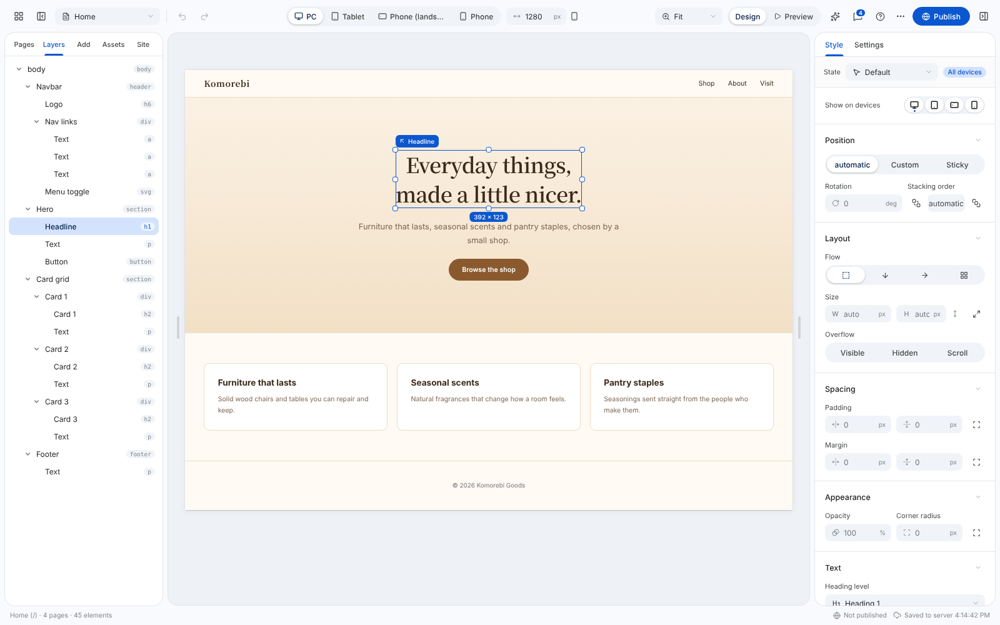
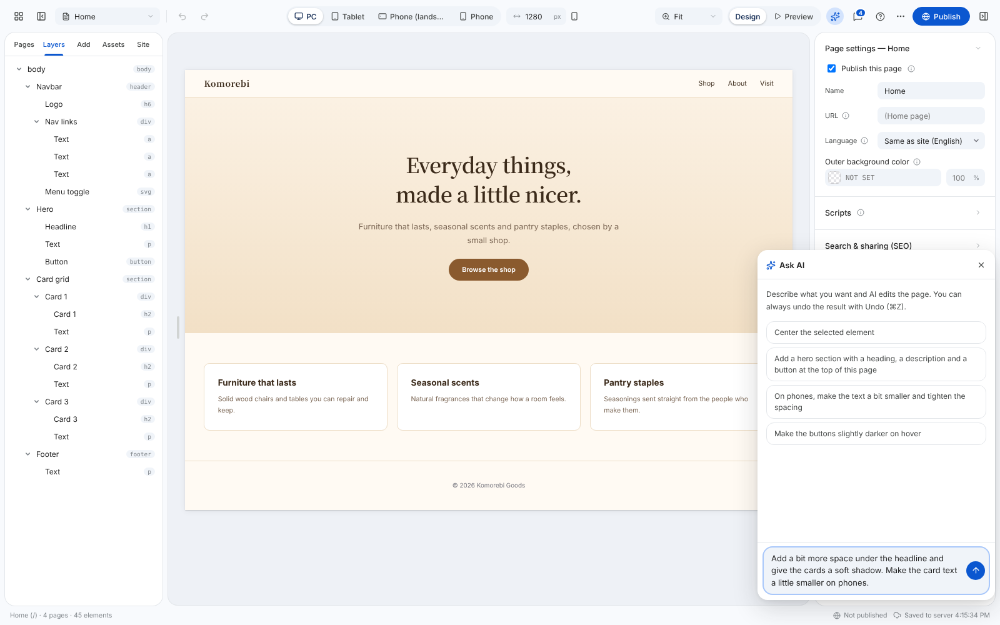
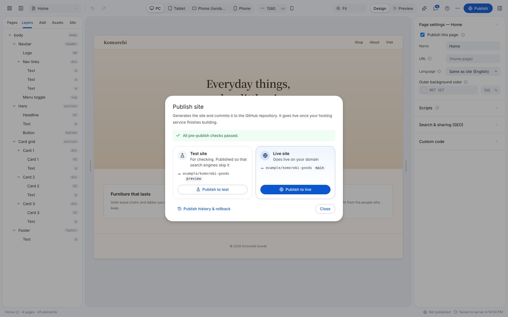
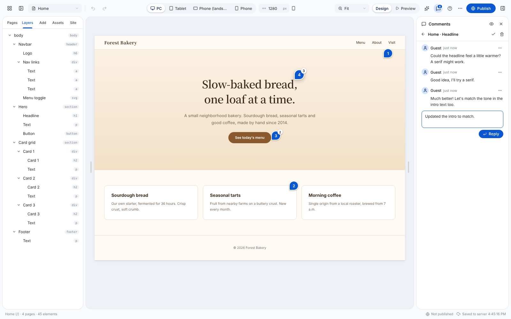
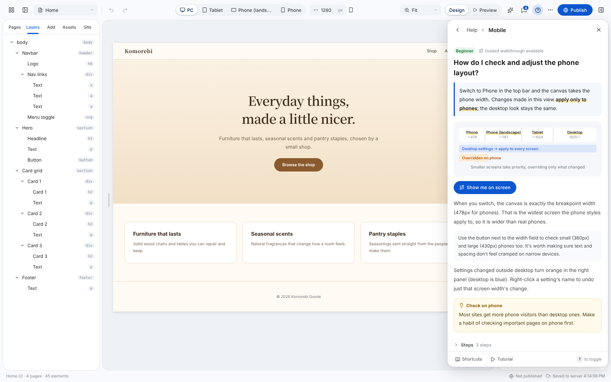
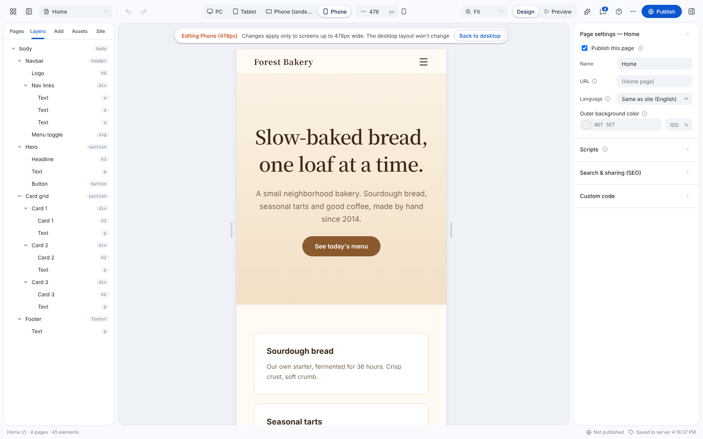
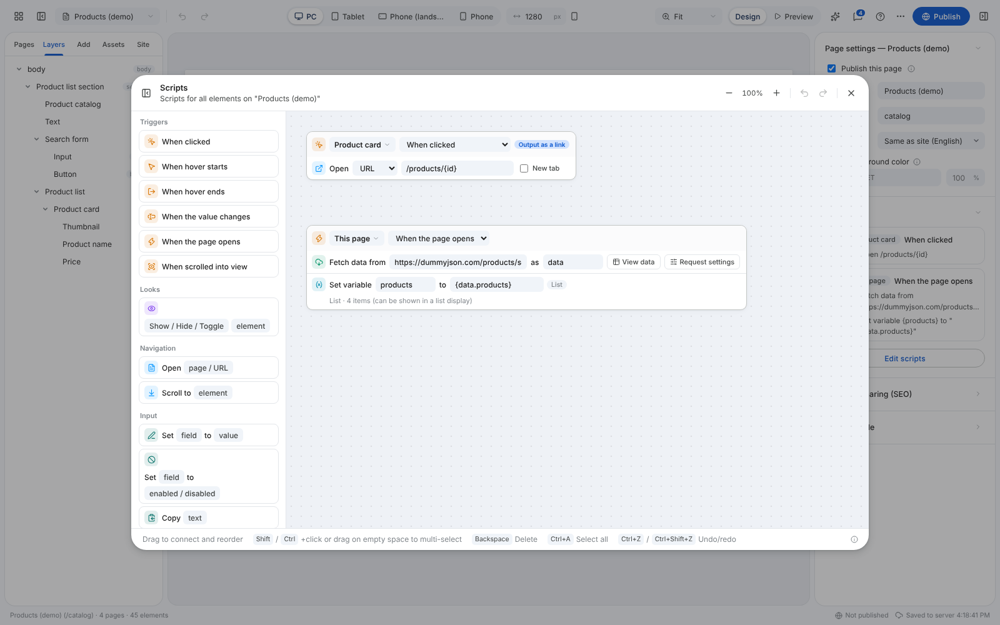

<h1 align="center">Tsumu</h1>

<p align="center">
  <strong>Design freely. Build openly.</strong><br>
  An open-source no-code website editor.
</p>

<p align="center">
  <a href="LICENSE"></a>
  
  
  
  
  
  <a href="CONTRIBUTING.md"></a>
</p>

<p align="center">
  <a href="https://tsumu.ebii.net"><strong>Try the demo</strong></a> · English · <a href="README.ja.md">日本語</a>
</p>

<p align="center">
  
</p>

Tsumu lets you create websites with intuitive actions such as dragging and dropping, without writing code. You can export or publish them as standard projects, so you can host them anywhere and edit the code **without depending on Tsumu**.

## Features

- **Visual editing:** Edit styles, hover states, other state changes, and animations without prior web development knowledge.
- **No-code scripts:** Build JavaScript by intuitively assembling blocks.
- **External data:** Fetch and use JSON from APIs.
- **Import:** Restore a project from a Tsumu ZIP or `doc.json`. Drop an HTML file or a website ZIP on the home screen to convert its pages into editable elements. Imported forms retain their submission method and field names.
- **Flexible output:** Export to Next.js, React, Vue, Nuxt, SvelteKit, or HTML, with a choice of TypeScript, JavaScript, and CSS formats.
- **GitHub publishing:** Publish to GitHub with one click, including support for production and preview branches.
- **Real-time collaboration:** Edit together with others and leave comments.
- **Optional AI editing:** Describe the changes you want in plain language to edit pages.
- **Self-hosting:** Run on Cloudflare Workers, Node.js, or Docker.
- **Help and languages:** Built-in tutorials, illustrated Q&A, and on-screen guides.

## Screenshots

<table>
  <tr>
    <td width="50%"><br><sub><b>Ask AI</b></sub></td>
    <td width="50%"><br><sub><b>Publish</b>: Push to GitHub</sub></td>
  </tr>
  <tr>
    <td width="50%"><br><sub><b>Comments</b></sub></td>
    <td width="50%"><br><sub><b>Built-in help</b></sub></td>
  </tr>
  <tr>
    <td width="50%"><br><sub><b>Responsive editing</b></sub></td>
    <td width="50%"><br><sub><b>No-code scripts</b></sub></td>
  </tr>
</table>

## Quick start

Requires **Node.js 26.12.1+** and **npm 12.2.1+**.

```bash
git clone https://github.com/abshrimp/tsumu.git
cd tsumu
npm ci
npm run dev
```

Open [http://localhost:3000](http://localhost:3000) and create a site. Local development needs no API keys or sign-in.

## Publishing and deployment

To push a site from Tsumu, create a GitHub repository, give a fine-grained token **Contents: Read and write** access to that repository, and set it as `GITHUB_TOKEN`. Select the repository in the site's settings. You can also export a ZIP without a token.

The editor runs on **Cloudflare Workers**, **Node.js** or **Docker**. For persistent storage, configure D1, Durable Objects and KV on Cloudflare, or `TSUMU_DATA_DIR` on Node.js/Docker. Without server storage, site data is stored only in the browser.

> [!IMPORTANT]
> Configure [Google sign-in](docs/user-guide.md#google-sign-in) before exposing the editor publicly. When sign-in is unconfigured, `npm run dev` and `ALLOW_ANONYMOUS=true` both grant anonymous access. Anyone who can reach that instance can edit and, if a GitHub token is configured, publish.

See the [detailed guide](docs/user-guide.md) for deployment commands, authentication, publishing formats, environment variables, backups and limitations.

## Documentation

- [Detailed guide](docs/user-guide.md) · [日本語](docs/user-guide.ja.md)
- [Architecture](ARCHITECTURE.md) · [Environment variables](.env.example)
- [Contributing](CONTRIBUTING.md) · [Security](SECURITY.md) · [Code of conduct](CODE_OF_CONDUCT.md)

## License

[MIT](LICENSE) © abshrimp
