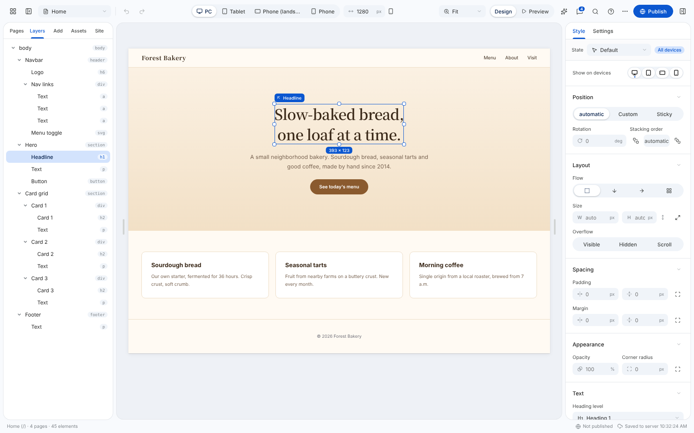
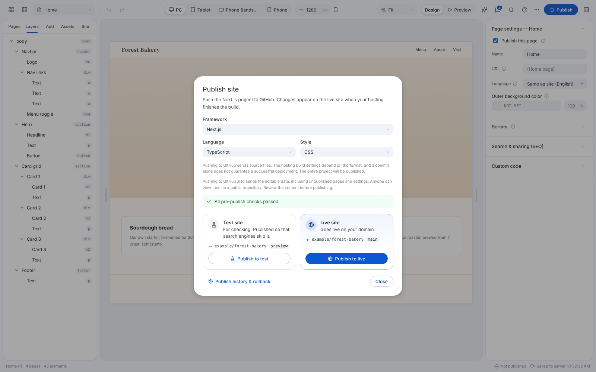

<p align="center">
  <picture>
    <source media="(prefers-color-scheme: dark)" srcset="docs/tsumu-logo-dark.svg">
    
  </picture>
</p>

<p align="center">
  <strong>Design freely. Build openly.</strong><br>
  An open-source no-code website editor.
</p>

<p align="center">
  <a href="LICENSE"></a>
  
  
  
  
  
  <a href=".github/CONTRIBUTING.md"></a>
</p>

<p align="center">
  <a href="https://tsumu.ebii.net"><strong>Try the demo</strong></a> · English · <a href="README.ja.md">日本語</a>
</p>

<p align="center">
  
</p>

Tsumu lets you create websites with intuitive actions such as dragging and dropping, without writing code. You can export or publish them as standard projects, so you can host them anywhere and edit the code **without depending on Tsumu**.

## Features

- **Visual editing:** Edit styles, hover states, and animations without prior web development knowledge.
- **No-code scripts:** Build scripts simply by arranging blocks.
- **External data:** Fetch and use data from APIs, including for CMS-style sites.
- **Import & backup:** Import HTML files or Tsumu-format files, and create backups.
- **Flexible output:** Export Next.js, React, Vue, Nuxt, SvelteKit, or HTML projects.
- **Direct publishing:** Publish to GitHub, GitLab.com, Netlify, or Cloudflare Pages in a few steps.
- **Real-time collaboration & site permissions:** Edit together in real time and leave comments.
- **AI integration:** Edit pages using [SKILL.md](skills/tsumu/SKILL.md), the built-in AI chat, or external AI apps through an MCP server.
- **Self-hosting:** Run on Cloudflare Workers, Node.js, or Docker.
- **Help and languages:** Built-in tutorials, illustrated Q&A, and on-screen guides.

## Tsumu AI Skill

Create editable Tsumu sites with the [Tsumu Skill](docs/skills.md). See the [AI-specific installation guide](docs/skills.md) for download and setup.

## Screenshots

<table>
  <tr>
    <td width="50%"><br><sub><b>AI chat editing</b></sub></td>
    <td width="50%"><br><sub><b>Publish by uploading</b></sub></td>
  </tr>
  <tr>
    <td width="50%"><br><sub><b>Commenting</b></sub></td>
    <td width="50%"><br><sub><b>Built-in help</b></sub></td>
  </tr>
  <tr>
    <td width="50%"><br><sub><b>Responsive editing</b></sub></td>
    <td width="50%"><br><sub><b>No-code scripting</b></sub></td>
  </tr>
</table>

## Quick start

Requires **Node.js 26.12.1+** and **npm 12.2.1+**.

```bash
git clone https://github.com/abshrimp/tsumu.git
cd tsumu
npm ci
npm run dev
```

Open [http://localhost:3000](http://localhost:3000) and create a site. Local development needs no API keys or sign-in.

## Deployment and publishing

The editor runs on Cloudflare Workers, Node.js or Docker. With server storage (D1, Durable Objects and KV on Cloudflare Workers, `TSUMU_DATA_DIR` on Node.js, or a volume at `/data` on Docker), you can edit from other devices and collaborate with others. Without it, editing data stays in the browser that created it.

Choose one publishing target for the server with `PUBLISH_PROVIDER`:

| `PUBLISH_PROVIDER` | How sites are published | What you configure |
|---|---|---|
| `github` (default) | Commits to a GitHub or GitLab.com repository | `GITHUB_TOKEN` or `GITLAB_TOKEN` |
| `netlify` | Uploads static files to each user's own Netlify account | A Netlify OAuth app |
| `cloudflare` | Uploads static files to Cloudflare Pages | A Cloudflare API token and server storage |

ZIP export works without any publishing configuration.

> [!IMPORTANT]
> If the editor can be reached from the internet, set up [Google sign-in](docs/user-guide.md#google-sign-in). To run it without sign-in, keep editing data in the browser and keep publishing tokens off the server (see the [Netlify example](docs/user-guide.md#netlify-publishing-without-sign-in)).

See the [detailed guide](docs/user-guide.md) for deployment steps, per-target setup, environment variables, backups and limitations.

## Documentation

- [Detailed guide](docs/user-guide.md) · [日本語](docs/user-guide.ja.md)
- [Architecture](docs/ARCHITECTURE.md) · [Environment variables](.env.example)
- [Contributing](.github/CONTRIBUTING.md) · [Security](.github/SECURITY.md) · [Code of conduct](.github/CODE_OF_CONDUCT.md)

## License

[MIT](LICENSE) © abshrimp
