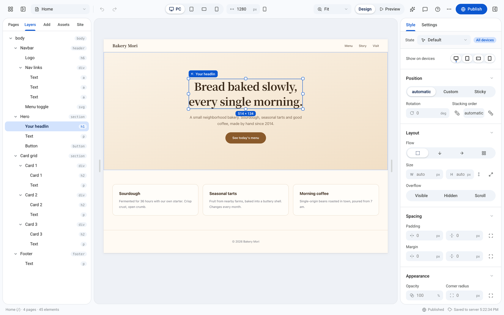
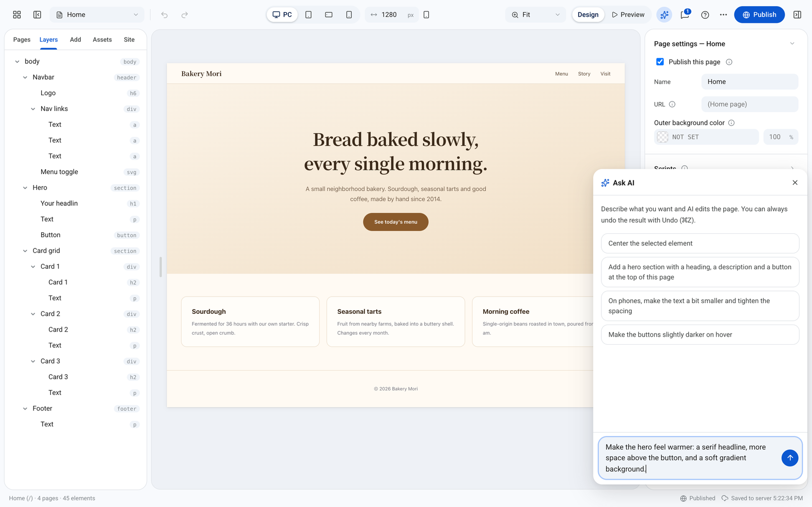
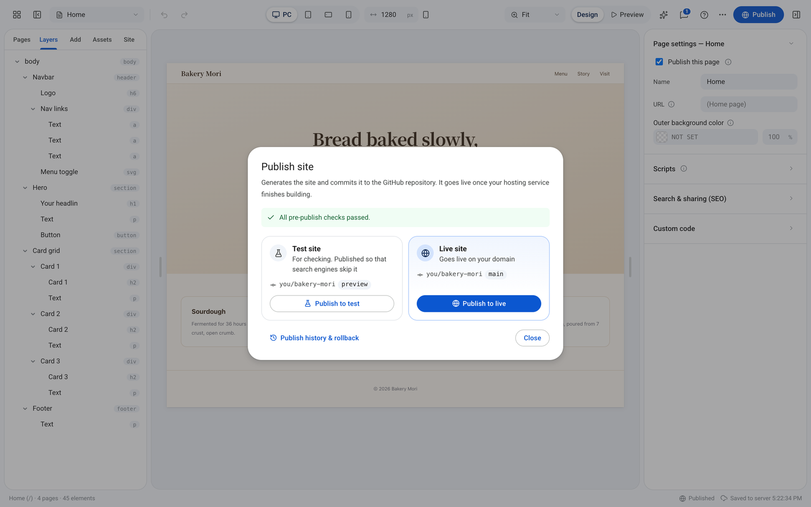
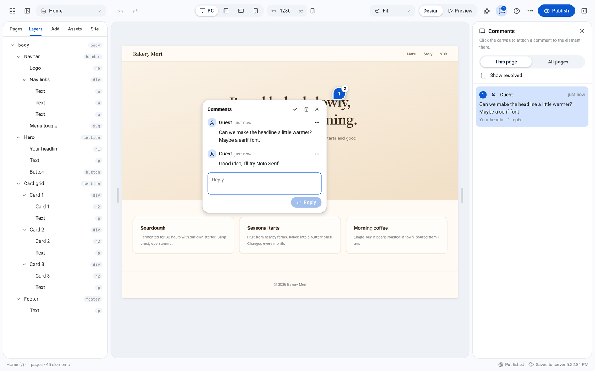
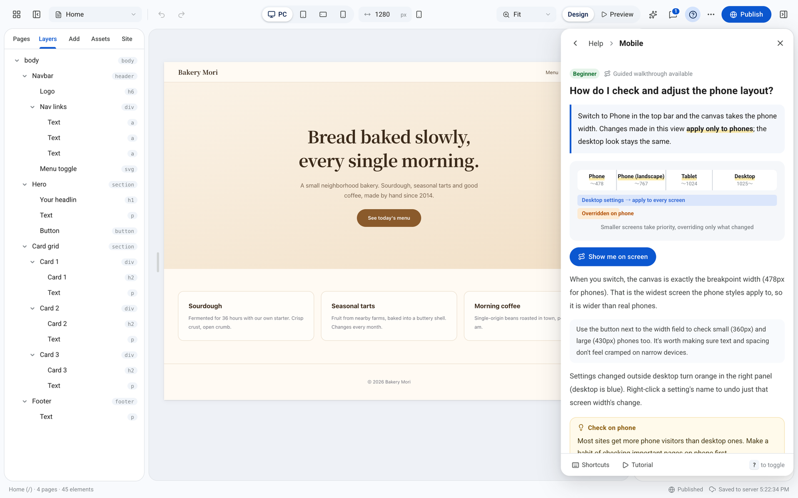
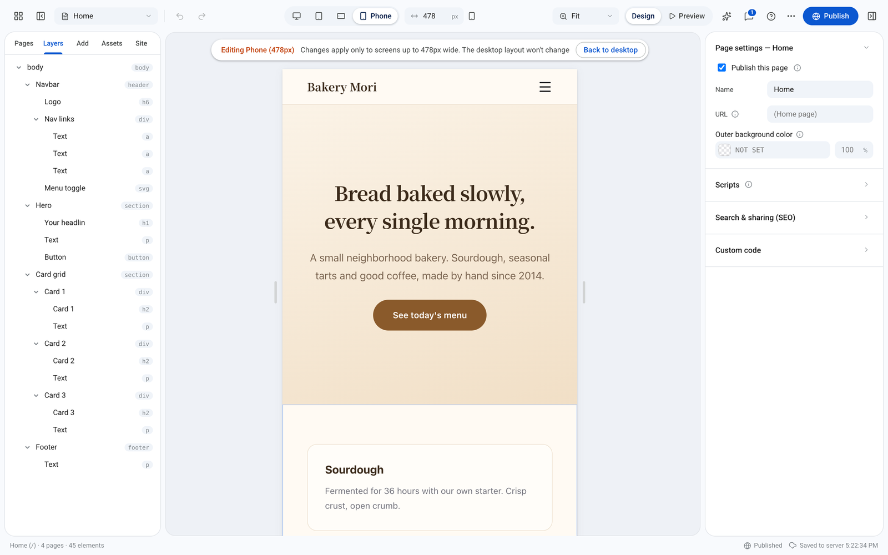
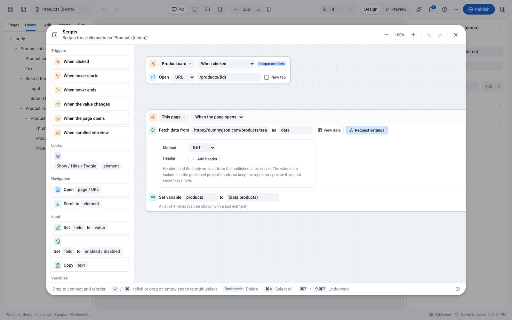

<h1 align="center">Tsumu</h1>

<p align="center">
  <strong>Design freely. Build openly.</strong><br>
  An open-source visual website builder.
</p>

<p align="center">
  <a href="LICENSE"></a>
  
  
  
  
  
  <a href="#contributing"></a>
</p>

<p align="center">
  <a href="https://tsumu.ebii.net"><strong>Try the demo</strong></a> · English · <a href="README.ja.md">日本語</a>
</p>

<p align="center">
  
</p>

Tsumu lets you lay out and style pages on a canvas, then publishes them as a **plain Next.js project** to your GitHub repository. The exported site has no runtime dependency on Tsumu, so there's no lock-in: host it on Vercel, Netlify, Cloudflare Workers or any Node.js server. Files you add to the site repository by hand (API routes, components, config) are kept on the next publish, so you can mix the editor with your own code.

One editor manages any number of sites. Each site has its own editing data and its own repository to publish to, and you create, duplicate and switch between them on the home screen.

## Features

- **Plain code you own**: the published site is readable Next.js that depends only on `next`, `react` and `react-dom`
- **Visual editing**: flexbox and grid layout, per-breakpoint styles, hover and active states, motion, components and lists
- **Scripts without code**: "when → do" blocks for clicks, menus, scrolling, form input, filtering, sorting and storage
- **External data**: fetch JSON from any API, show it in lists, and generate a detail page per item (`/news/[slug]`)
- **Real-time collaboration**: several people can edit at once with per-property merging, leave comments on the canvas, and see who edited and published
- **Publishing through GitHub**: one click commits the generated project; test publishes go to a preview branch that search engines skip
- **Pre-publish checks**: broken links, missing alt text, heading order, text too small on phones and layouts that overflow on phones are caught before going live
- **History and rollback**: return the live site to any published version, or restore the editor content from a published version or a daily server backup
- **Ask AI (optional)**: describe a change in plain language and AI edits the page; one undo reverts it. Works with Claude, Gemini, OpenAI or any OpenAI-compatible API
- **Built-in help**: a tutorial, a searchable Q&A manual with diagrams, and guided tours that point at the screen
- **Multiple sites**: create, duplicate and delete sites; copy elements or whole pages between sites along with their images and components
- **Run it anywhere**: the editor runs on Cloudflare Workers (the free plan is enough), Node.js or Docker, and every service is optional
- **English and Japanese UI**, with room for more languages

## Screenshots

<table>
  <tr>
    <td width="50%"><br><sub><b>Ask AI</b></sub></td>
    <td width="50%"><br><sub><b>Publish</b>: checks, then a test site or the live site</sub></td>
  </tr>
  <tr>
    <td width="50%"><br><sub><b>Comments</b></sub></td>
    <td width="50%"><br><sub><b>Built-in help</b></sub></td>
  </tr>
  <tr>
    <td width="50%"><br><sub><b>Responsive editing</b></sub></td>
    <td width="50%"><br><sub><b>Scripts without code</b></sub></td>
  </tr>
</table>

## How it works

```
Tsumu (this repository)
│  Runs on Cloudflare Workers, Node.js or Docker
│  Home (list of sites) · Editor /sites/<id> · Google sign-in (optional)
│
│  Publish → main  /  Test publish → preview
▼
One repository per site (GitHub)
│  Site A, Site B, … (each with main = production, preview = test)
│
│  Each branch is built automatically
▼
Hosting (your choice)
   Vercel / Netlify / Cloudflare Workers / Node.js
```

- **The editor** is a Next.js app that runs on Cloudflare Workers, Node.js or Docker (see [Deploying the editor](#deploying-the-editor)). The list of sites, editing data, comments, the edit/publish activity log, the sign-in allowlist and uploaded images, video and audio (shared by all sites) go to the storage that matches where it runs.
- **The published site** is an ordinary Next.js app committed to that site's repository. It does **not** need to run where the editor runs.
- **Test publishing** commits to another branch (`preview` by default) of the same repository. Vercel, Cloudflare Workers Builds and Netlify build non-production branches as previews automatically, so one hosting project covers both. The test build is excluded from search engines (robots.txt, `noindex`, `X-Robots-Tag` and crawler blocking).

## What you need

Everything is **optional**. The editor opens and edits even when something is missing.

| Setting | Without it | With it |
|---|---|---|
| Server storage (D1 and KV on Cloudflare, `TSUMU_DATA_DIR` on Node.js and Docker) | Sites, editing data, comments and images are saved in the browser (only that browser sees them; images up to 2 MB each) | Saved on the server: edit and comment from other devices and with other people, with daily backups and a record of who edited and published (images up to 25 MB each) |
| Google sign-in (`AUTH_*`) | Doesn't open (shows how to set it up). With `ALLOW_ANONYMOUS=true`, and in `npm run dev`, it opens without signing in (**anyone with the URL can edit and publish**) | Only the Google accounts you allow can use it |
| `GITHUB_TOKEN` | **Publish** explains what to set up (zip export still works) | Publishes to the repository set in each site's settings |
| `AI_*` | No **Ask AI** button | **Ask AI** is available |

Always set up Google sign-in for an editor that's reachable from the internet. Run without sign-in only on your own machine, or for a demo with no publish target (`GITHUB_TOKEN`).

## Quick start (local)

Requires Node.js 22.16+ (22.x) or 24+. If you use nvm, run `nvm use` after cloning.

```bash
git clone https://github.com/abshrimp/tsumu.git
cd tsumu
npm ci
npm run dev
```

Open http://localhost:3000 to see the home screen (the list of sites). **New site** creates one and opens its editor at `/sites/<id>`.

`npm run dev` emulates Cloudflare's D1 and KV locally from `wrangler.jsonc` (data goes to `.wrangler/state` and takes precedence over `TSUMU_DATA_DIR`). It runs without any environment variables, and sign-in is skipped (only in `npm run dev`; for `npm run preview`, put `ALLOW_ANONYMOUS=true` in `.dev.vars`). Collaboration falls back to polling there; use `npm run preview` to try the WebSocket path.

## Deploying the editor

The editor runs on any of the three below. The features are the same; what differs is the storage and how collaborators' changes arrive.

| | Cloudflare Workers | Node.js | Docker |
|---|---|---|---|
| Storage | D1 (database) and Workers KV (images and files) | The `TSUMU_DATA_DIR` folder (SQLite and files) | `/data` in the container (mount a volume) |
| Collaborators' changes | Immediately (WebSocket via a Durable Object) | Immediately (Server-Sent Events) | Immediately (Server-Sent Events) |
| Cost | Runs on the free plan (see [Limits](#limits)) | Your server | Your server |
| Good for | Running without a server of your own | Running on your machine or an existing server | Managing it as a container |

In every case, tables are created on first access (no migrations). Without server storage, data is kept in the browser (see [What you need](#what-you-need)).

### Common setup

#### Google sign-in

1. Create an OAuth client ID (web application) in the [Google Cloud Console](https://console.cloud.google.com/apis/credentials)
2. Add the authorized redirect URIs
   - `https://<editor-domain>/api/auth/callback/google`
   - `http://localhost:3000/api/auth/callback/google` (to try sign-in locally)
3. The OAuth consent screen can stay in testing mode (add yourself as a test user)

Sign-in turns on once `AUTH_SECRET`, `AUTH_GOOGLE_ID` and `AUTH_GOOGLE_SECRET` are all set. Set `AUTH_URL` to the editor's URL. Accounts in `ALLOWED_EMAILS` can always sign in; add others on the home screen under **Settings → Accounts that can sign in** (needs server storage).

#### GitHub token

Create a **fine-grained personal access token** with **Contents: Read and write** on every repository you publish to. One token is shared by all sites. When you add a site, add its repository to the token too (or give the token access to "All repositories").

Each site's repository is set on the home screen under the site's **… → Settings** (see [Publish targets](#publish-targets)).

### Cloudflare Workers

**1. Create the storage (optional)**

```bash
npx wrangler login
cp wrangler.jsonc wrangler.local.jsonc
npx wrangler d1 create tsumu                  # put the printed database_id in wrangler.local.jsonc
npx wrangler kv namespace create ASSETS_KV    # put the printed id in wrangler.local.jsonc
```

`wrangler.local.jsonc` is ignored by Git, so your IDs never end up in the repository. `npm run dev`, `npm run preview` and `npm run deploy` use it automatically when it exists (or the file named by `WRANGLER_CONFIG`). Bindings without an ID are dropped at deploy time, so you can create one of the two, or neither.

**2. Set the secrets and deploy**

Set each variable with `npx wrangler secret put <NAME>` (see [Environment variables](#environment-variables); add `--config wrangler.local.jsonc` if you use that file), then deploy:

```bash
npm run deploy
```

To deploy on every push with Cloudflare Workers Builds, connect the repository and set:

- Build command: `node scripts/cloudflare.mjs build`
- Deploy command: `node scripts/cloudflare.mjs deploy`
- Non-production branch deploy command: `node scripts/cloudflare.mjs upload`
- Build variables (Settings → Build → Variables and secrets, optional): `D1_DATABASE_ID` and `KV_NAMESPACE_ID`

At build time the script writes a deploy config (`wrangler.generated.jsonc`) from `wrangler.jsonc`, filling in the IDs from the build variables and dropping bindings that have none, so the IDs never have to be committed.

### Node.js

Requires Node.js 22.16+ (22.x) or 24+. If you use nvm, run `nvm use` after cloning. Set `TSUMU_DATA_DIR` to a folder, and the editor keeps its data in `<folder>/tsumu.db` (SQLite) and uploads in `<folder>/assets/`. It uses the built-in `node:sqlite`, so there's nothing extra to install.

```bash
npm ci
npm run build
TSUMU_DATA_DIR=./data npm start
```

To try it on your machine without sign-in, add `ALLOW_ANONYMOUS=true`, as in `ALLOW_ANONYMOUS=true TSUMU_DATA_DIR=./data npm start`.

Set the other variables in `.env.local` or the server's environment (see [Environment variables](#environment-variables)). `PORT` changes the port (default 3000).

- To back up, copy the whole `TSUMU_DATA_DIR` folder. SQLite also keeps recent writes in `tsumu.db-wal`, so copy `tsumu.db`, `tsumu.db-wal` and `tsumu.db-shm` together, ideally with the editor stopped.
- Behind a reverse proxy such as nginx, set `AUTH_URL` to the public URL and have the proxy forward `X-Forwarded-Host` and `X-Forwarded-Proto`, so Google sign-in redirects back to the right address.
- Run only one editor per `TSUMU_DATA_DIR` (collaborators' changes are relayed inside a single process).
- Make sure the reverse proxy streams `/api/collab/events` without buffering (nginx does this automatically thanks to the `X-Accel-Buffering: no` response header).

### Docker

The image contains the Node.js editor and stores its data in `/data` inside the container.

```bash
docker build -t tsumu .
docker run -d --name tsumu -p 3000:3000 -v tsumu-data:/data --env-file .env.local tsumu
```

To try it on your machine without sign-in, add `-e ALLOW_ANONYMOUS=true`.

Pass environment variables with `--env-file` (or `-e`); see [Environment variables](#environment-variables). Leave `TSUMU_DATA_DIR` out of that file, or the data would be stored outside the volume.

**Where the data lives**

```
/data/
  tsumu.db, tsumu.db-wal, tsumu.db-shm   Sites, editing data, comments, backups and so on (SQLite)
  assets/data/                            Uploaded images, video and other files
  assets/meta/                            Each file's Content-Type
```

- `-v tsumu-data:/data` stores it in the Docker named volume `tsumu-data`. Recreate the container with the same volume and the data is still there.
- To keep it in a folder on the host, use `-v "$(pwd)/data:/data"`. The container runs as the `node` user (UID 1000), so on Linux give that folder to it first (`sudo chown 1000:1000 data`).
- **Don't start it without `-v`.** The data would go to an anonymous volume, and a recreated container wouldn't see it.

To back up the named volume (stopping the container first is the safe way):

```bash
docker stop tsumu
docker run --rm -v tsumu-data:/data -v "$(pwd)":/backup busybox tar czf /backup/tsumu-data.tgz -C /data .
docker start tsumu
```

Reverse proxy setup is the same as for [Node.js](#nodejs).

## Publish targets

On the home screen, open a site's **… → Settings** to set the following. You can set them when creating the site or later.

| Field | Description |
|---|---|
| GitHub repository | `owner/name`. You can edit without one, but you can't publish |
| Production branch | Default `main` |
| Test branch | Default `preview`. Leave empty to turn off test publishing |
| Live site URL / test site URL | Optional. The Publish dialog links to them |

Create the repository for the generated site first (empty, or initialized with a README).

## Hosting the published site

After the first publish, connect the site's repository to a host.

| Host | Setup | Test publishes |
|---|---|---|
| **Vercel** | Import the repository. No configuration needed | Every non-production branch gets a preview URL |
| **Netlify** | Import the repository | Enable branch deploys |
| **Cloudflare Workers Builds** | Build: `npx opennextjs-cloudflare build`<br>Deploy: `npx opennextjs-cloudflare deploy` | Non-production branch deploy command: `npx opennextjs-cloudflare upload` (enable preview URLs) |
| **Node.js** | `npm install && npm run build && npm start` | Build the test branch separately |

### Data refresh interval and Cloudflare

Pages that fetch external JSON are rebuilt at the **Data refresh interval** set in the editor's **Site** tab:

- **Standard** hosting (Vercel, Netlify, Node.js) uses Next.js ISR: pages are prebuilt and regenerated in the background.
- On **Cloudflare Workers**, ISR needs an extra incremental cache (R2) and queue. Without them, prebuilt pages are never regenerated. In the editor's **Site** tab, choose **Hosting → Cloudflare Workers** and the editor exports those pages to render on each request while caching the fetched JSON at Cloudflare's edge for the interval instead.

An interval of `0` fetches on every request on any host.

### Rollback

**Publish → Publish history & rollback** (or **⋯ → History**) lists the commits on each branch.

- **Restore site** commits the selected version's files again on top of the branch, so the history is kept and the rollback itself can be undone.
- **Restore edits** loads the editor content saved with that publish (`_tsumu/doc.json`). It's a normal edit, so ⌘Z reverts it.

The same dialog also lists the server's daily backups of the editor content (one per weekday, seven in total).

## Ask AI (optional)

Set `AI_ENABLED=true` and an API key to show the **Ask AI** button. Requests run through `/api/ai` on the editor's server, so the key never reaches the browser.

How it works: the browser sends a compact outline of the page being edited (element tree, text and styles; other pages only by name). The server adds a fixed description of the editor's data model and an `edit_site` tool, and the model answers with edit operations (set a style, insert or move an element, change text, …). The server tries them on a copy of the page and returns any errors to the model so it can fix them; the operations that apply cleanly go back to the browser and are applied as one undoable change. It doesn't edit scripts, data sources or assets.

| `AI_PROVIDER` | API key | Default `AI_MODEL` | Notes |
|---|---|---|---|
| `anthropic` (default) | `ANTHROPIC_API_KEY` | `claude-opus-5-5` | `claude-sonnet-5-5` or `claude-haiku-5-5` cost less |
| `gemini` | `GEMINI_API_KEY` | `gemini-3.8-flash` | Uses Gemini's OpenAI-compatible endpoint. `gemini-2.5-flash-lite` is the cheapest; there's a free tier |
| `openai` | `OPENAI_API_KEY` | set `AI_MODEL` | |
| `openai-compatible` | `AI_API_KEY` | set `AI_MODEL` | Any Chat Completions API with tool calling (OpenRouter, Ollama, …). Set `AI_BASE_URL` |

`AI_API_KEY` works for every provider. `AI_EFFORT` (`low` … `max`, default `medium`) controls how much the model thinks; lower is cheaper. Smaller models make more mistakes with edit operations; the server catches them, but requests take more round trips. Note that some free tiers (such as Gemini's) may use your requests to improve the provider's products.

### Using Gemini

Set these on the environment running the editor (`.env.local` locally and on Node.js, `--env-file` on Docker, or the Worker's Variables and Secrets in Cloudflare):

```dotenv
AI_ENABLED=true
AI_PROVIDER=gemini
AI_MODEL=gemini-3.8-flash
GEMINI_API_KEY=your-api-key
```

Store the API key as a secret. `AI_API_KEY` takes precedence over provider-specific keys, so remove an old shared key when switching providers. Use the table above to switch to Claude, OpenAI or a compatible API.

While signed in, open `/api/ai` to check availability and the selected model. If `AI_ENABLED` is set but AI stays unavailable, the missing configuration is written to the server log. Restart the editor (local, Node.js or Docker) or apply the Cloudflare configuration change, then return to the editor.

Edits are validated on a working copy. Connection failures, timeouts, unresolved tool errors and truncated generation do not apply changes. If you edit the target page while waiting, the AI result is rejected to preserve your work. Use the chat's stop button to cancel a request. Successful edits form a single undo step. The chat streams brief public explanations, preparation/validation/repair progress, and elapsed time. The activity log remains available after completion. Private reasoning and signatures are never displayed.

## Environment variables

All optional (see [What you need](#what-you-need)).

| Variable | Description |
|---|---|
| `AUTH_SECRET` | Session secret. Generate with `npx auth secret` |
| `ALLOW_ANONYMOUS` | `true` lets the editor open without sign-in when Google sign-in isn't set up (not needed in `npm run dev`). Anyone with the URL can then edit and publish, so use it only locally or for a demo |
| `AUTH_URL` | The editor's URL in production, e.g. `https://tsumu.example.com` |
| `AUTH_GOOGLE_ID` / `AUTH_GOOGLE_SECRET` | Google OAuth client |
| `ALLOWED_EMAILS` | Google accounts that can always sign in (comma-separated; can't be removed in the UI). Manage more under **Settings** on the home screen |
| `GITHUB_TOKEN` | Token with Contents: Read and write on every repository you publish to (shared by all sites) |
| `AI_ENABLED` | `true` to enable Ask AI |
| `AI_PROVIDER` | `anthropic` (default), `gemini`, `openai` or `openai-compatible` |
| `AI_API_KEY` | API key (or `ANTHROPIC_API_KEY` / `GEMINI_API_KEY` / `OPENAI_API_KEY`) |
| `AI_MODEL` | Model ID. Defaults to `claude-opus-5-5` (anthropic) or `gemini-3.8-flash` (gemini) |
| `AI_BASE_URL` | API URL for `openai-compatible`, e.g. `https://openrouter.ai/api/v1` |
| `AI_EFFORT` | `low`, `medium` (default), `high`, `xhigh` or `max` |
| `TSUMU_DATA_DIR` | Storage folder on Node.js ([Node.js](#nodejs); fixed to `/data` on Docker) |

Put them in `.env.local` for local development and Node.js, in the `--env-file` file for Docker, or set them with `wrangler secret put` on Cloudflare (see [`.env.example`](.env.example)).

## Limits

### Cloudflare free plan (when running on Cloudflare Workers)

| Item | Limit | Effect |
|---|---|---|
| Workers CPU time | 10 ms per request | Publishing an asset-heavy site can exceed it. Workers Paid ($5/month, 30 s CPU) removes the issue |
| D1 value size | about 2 MB | One site's editing data (JSON, without images) has to fit |
| KV | 1 GB total, 25 MB per file, 1,000 writes/day | Storage is shared by all sites; the Assets tab shows the total for all sites |
| KV consistency | Eventual | A new upload can take a few seconds to show up everywhere |
| GitHub API | 5,000 requests/hour | A publish uses a few to a dozen or so |

### Sites

- Deleting a site deletes its editing data and automatic backups. The published repository and the images in storage stay.
- Images copied between sites share the same file. A file another site uses isn't removed from storage when you delete it as unused.
- Without D1, sites live only in that browser, so clearing the browser's data loses them.

### Collaboration

- Comments are stored separately from the editing data: they aren't published, aren't part of undo, and only their authors can edit or delete them.
- Who edited and published is recorded per person (the latest time for each). Without Google sign-in, everyone appears as one guest.
- Merging works per property. Edits to different elements, or to different properties of the same element (say, its text and its color), are both kept; for the same property, the later save wins. Lists such as a script's steps count as a single property.
- While you have unsaved changes or are typing, other people's changes are applied once you're done.
- Applying other people's changes rebuilds your undo history to match.
- Removing an account from the allowlist blocks its existing sessions on the next API request. Open collaboration connections check permission before reading, writing or receiving further updates.

### Editor and export

- A publish is a normal commit. Files Tsumu generated are replaced with the editor's version, and files you added by hand are kept (`_tsumu/generated.json` tells them apart). If a generated file was edited on GitHub, the editor asks before overwriting it. To keep changing generated files by hand, do it on another branch.
- The first publish also preserves existing files and asks before overwriting a matching path. `_tsumu/` is reserved for Tsumu metadata. A malformed generated-file manifest stops publishing.
- Page-specific custom code is inserted at the top of the page body, not in `<head>`.
- On the canvas, custom code and icons are shown sanitized: their scripts and event handlers run only on the published site, so they can't act with your editor session.
- `next/image` is exported with `unoptimized` so it works on every host.
- HTML pages (raw HTML) don't get the shared layout, metadata or custom code.
- After splitting text into spans, edit each span separately.
- Sign-in supports Google accounts only.

## Development

[ARCHITECTURE.md](ARCHITECTURE.md) explains the `SiteDoc` data model and how publishing, collaboration and AI edits work.

```
app/
  page.tsx            Home (list of sites)
  sites/[id]/         Editor
  login/              Sign-in page
  api/sites/          List, create, configure and delete sites
  api/doc/            Per-site editing data and daily backups
  api/comments/       Comment threads on the canvas
  api/activity/       Who edited recently and who published last
  api/publish/        Generate → commit to GitHub, history and rollback
  api/assets/         Uploads, file serving and storage usage
  api/ai/             Ask AI
components/           UI (Home, Editor, Canvas, panels, ScriptEditor, HelpCenter, …)
  canvas/ left-panel/ style-panel/ script-editor/   Parts of the large components
lib/
  sites.ts            Site types, input validation and D1 storage
  site.ts             Current site, browser storage keys, and the browser-only site list without D1
  generator.ts        SiteDoc → Next.js project (parts in generator/)
  script-runtime.ts   Script runtime shared by the canvas and exported sites
  node-storage.ts     SQLite and file storage outside Cloudflare (TSUMU_DATA_DIR)
  store.ts            Editor state (zustand) and undo history
  clip-transfer.ts    Copy and paste between sites
  page-transfer.ts    Copy pages to another site
  comments.ts         Comment threads (D1 and browser storage)
  activity.ts         Edit and publish activity log
  aiOps.ts            AI edit operations (applied on the server and in the browser)
  manualTopics.ts     Help articles
  locales/            English translations
custom-worker.ts      Cloudflare Worker entry, including the collaboration Durable Object
scripts/cloudflare.mjs  Writes the deploy wrangler config and runs OpenNext
```

```bash
npm run typecheck      # tsc --noEmit
npm test               # regression tests for collaboration, undo, scripts, publishing and more
npm run i18n:check     # missing English translations (other languages: npm run i18n:check -- <code>)
npm run build && npm run test:e2e   # end-to-end tests in a real browser (Playwright; first run: npx playwright install chromium)
```

### Translations

UI strings are written in Japanese and wrapped in `tr("…")` (`lib/i18n.ts`). Each other language has a dictionary in `lib/locales/<lang>.ts` that maps the Japanese source to the translation (help and tutorial strings for English are split into `en-help.ts`). A missing entry falls back to English, then to the Japanese source. Use `tr("{name}を削除", { name })` for placeholders.

#### Adding a language

1. Add the language to `LANGUAGES` in `lib/lang.ts` (the key is a BCP 47 code such as `zh`, `ko` or `fr`).
2. Create `lib/locales/<code>.ts` exporting a `Dict`. Copying `en.ts` and translating the values is the quickest start; untranslated entries can simply be left out.
3. Register it in `LOCALES` in `lib/locales/index.ts`.
4. Run `npm run i18n:check -- <code>` to list what's left.

The language then appears under **Settings → Language** on the home screen (and **⋯ → Settings** in the editor), and is picked automatically from the browser's language.

### Help articles

Articles are in `lib/manualTopics.ts`: a question, a one-line answer and a body of blocks (paragraphs, lists, tables, tips and diagrams). Inline `**bold**`, `` `code` `` and `[[article-id|link text]]` are supported. Diagrams are React components in `components/HelpFigures.tsx`, drawn with the same CSS they explain. A guide step's `target` matches a `data-tutorial` attribute in the UI.

## Contributing

See [CONTRIBUTING.md](CONTRIBUTING.md) for the contribution workflow, [SECURITY.md](SECURITY.md) for private vulnerability reports and [CODE_OF_CONDUCT.md](CODE_OF_CONDUCT.md) for how we work together. Issues and pull requests are welcome. Before sending a change, run `npm run typecheck`, `npm test` and `npm run i18n:check` (GitHub Actions also runs them on pull requests). Add a test in `tests/` (or `e2e/` for UI flows) when you change behavior, and add English translations for any new UI text.

Code comments and UI source strings are written in Japanese (English translations live in `lib/locales/`). Issues and pull requests in English are welcome.

## License

[MIT](LICENSE) © abshrimp
