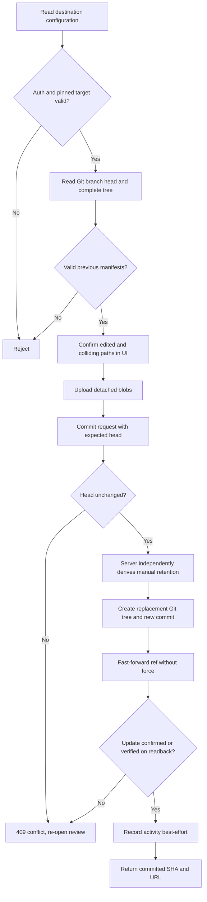
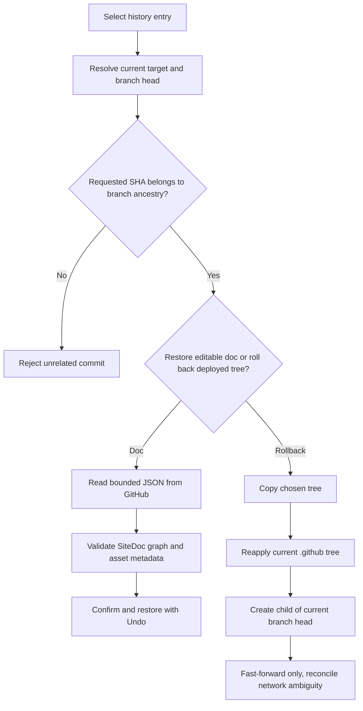

# G — GitHub publish and restore audit

- **Repository:** `abshrimp/tsumu`
- **Baseline:** `1ba32974d4b5ecf441e36428e765d0542207c421`
- **Branch:** `audit/G-publish`
- **Scope:** `app/api/publish/`, `lib/github.ts`, `lib/publish-files.ts`, `lib/publish-preconditions.ts`, `lib/publish-security.ts`, `components/PublishModal.tsx`, and associated tests.
- **Integration:** All G fixes belong to a single pull request. Independent review and final merge remain the responsibility of the integrator.

## Verified workflow (baseline)

1. The UI loads and confirms the selected destination before requesting a GitHub tree snapshot.
2. The server resolves the destination from authoritative site settings and requires the destination identity in subsequent requests.
3. The tree preflight reads the branch head, a recursive tree and publication manifests; clients calculate generated-file changes and files to retain.
4. Binary assets are uploaded as Git blobs before the commit request.
5. The commit endpoint checks the expected branch head, creates a replacement Git tree, creates a commit with the observed parent, and moves the branch ref with `force: false`.
6. History reads commits and editable document content from the destination; rollback constructs a new commit and also updates the ref without force.

## G audit checklist

| Area | Review targets |
| --- | --- |
| G-1 GitHub credentials | Token scope, redirect behavior, errors, logging |
| G-2 destination | Repository / branch validation, immutable target identity |
| G-3 paths | Traversal, symbolic links, submodules, protected paths |
| G-4 Git operations | Error responses, zero/partial results, tree chunks |
| G-5 concurrency | Concurrent publishers, stale snapshots, rejected ref writes |
| G-6 retention | Manual files, generated manifest, delete decisions, collisions |
| G-7 history and rollback | Reachability, preservation of protected files, trust boundary |
| G-8 retry and recovery | Ambiguous network results, post-commit bookkeeping failures |
| G-9 tests | Mock GitHub API abnormal conditions, publish / restore round trips |

## Coordination and pending verification

PR #19 modifies the import pipeline and PR #22 modifies account/style flows; neither changes the main G-owned files as of the audit baseline. This document is an incremental audit record, **not** a claim that the audit is complete. Findings, fixes, precise test results and any remaining risks will be documented here as they are established.

## State transitions

## Findings and fixes

| ID | Severity | Baseline issue | Resolution and coverage |
| --- | --- | --- | --- |
| AUD-G-001 | High | The server accepted an incomplete `keptPaths` list during whole-tree replacement, allowing manually added Git files to disappear. | Recalculate retention from the pinned Git tree and prior validated generated-file manifest. Tests cover omitted paths, file modes, submodules and intentional deletion of obsolete generated files. |
| AUD-G-002 | Medium | A guessed/known commit SHA from an unrelated branch could be used to read its editable document or replace the active site's published tree. | Require the SHA to be an ancestor of the selected branch's current head; reject unrelated commits. Mocked API checks cover both read and rollback and preserve ancestor behavior. |
| AUD-G-003 | Medium | A connection drop after a successful ref update could be reported as failure, prompting a duplicate retry. | Read back the ref after uncertain outcomes; accept success only when it equals the newly created commit. Keep `force: false` and conflict rejection. |
| AUD-G-004 | Medium | Local publish-activity recording could throw after GitHub commit success and cause a misleading failure response. | Separate post-commit bookkeeping from the committed result; emit a sanitized warning, return the successful commit. |
| AUD-G-005 | Medium | History restoration accepted shallowly plausible JSON without validating internal references, objects or prototype keys. | Apply the same full `SiteDoc` validator as document imports and cap the streamed JSON body before parsing. |
| AUD-G-006 | Low | Text and binary-SHA outputs could claim the same path, yielding ambiguous Git tree entries. | Reject conflicting destination paths before any remote writes. |
| AUD-G-007 | Low | GitHub API failures logged up to 300 characters of untrusted response text, potentially including sensitive request-related details. | Record only repository, step and status, without the raw response body. |

## Reproduction and regression coverage

- **Manual retention:** invoke a commit on a branch with `script.sh`, a symlink, a gitlink and an existing workflow, omitting `keptPaths`. Before the fix the replacement tree omitted unlisted files. After the fix the server explicitly re-adds all manual files from the authoritative tree.
- **Generated-file deletion:** when a previous generated manifest owns `app/obsolete.ts`, publish a new output without that path and preserve an unrelated `README.md`. Only the generated file should be deleted.
- **Cross-branch restoration:** supply a real-looking SHA whose GitHub compare merge base is not itself. Both historical `doc.json` reads and rollback must reject it without remote writes.
- **Ambiguous write:** simulate GitHub accepting a branch ref update before the connection fails. A readback resolving to the exact new SHA must return the commit as successful.
- **Bookkeeping outage:** make local `recordPublish` throw after the ref update. GitHub success remains success, not an invitation to retry.
- **Untrusted restored document:** test over-limit streamed input, malformed UTF-8 and JSON, prototype keys and broken document references.

## Remaining boundaries and integration checks

- **Token permissions:** the application uses a server-side `GITHUB_TOKEN` shared across configured sites. Minimum practical permission is a fine-grained token limited to intended repositories, with repository Contents read/write and Metadata read. The token's actual permissions cannot be established from source code and require deployment-owner verification.
- **Uncontrolled repositories:** this audit does not write to real publication targets. Tests use an isolated GitHub API mock to avoid destructive changes.
- **Delivery:** a Git commit means the source was pushed, not that an external host finished building or deploying it. Host-side production verification is a separate step.
- **Cross-project integration:** `lib/site-import.ts` is shared with the import team; the published-history restore reuses its exported validator without modifying that file.
- **Final acceptance:** review the final CI checks, CodeQL, main integration, external publish/restore smoke, and independent audit before merging. Do not mark the entire project free of vulnerabilities solely on the basis of G's tests.

## Second-pass audit (after the first green CI)

A green CI result at `ece4bb9a` established regression coverage only for the first pass. A new inspection of Git tree replacement, rollback and API-boundary assumptions found additional cases.

| ID | Severity | Finding | Correction |
| --- | --- | --- | --- |
| AUD-G-008 | High | A manual symlink/file at `public/assets` and generated `public/assets/logo.svg` are not the same path, so earlier collision logic could include both. GitHub's nested Git Trees API can replace one with the other. | Reject file/descendant prefix collisions before asset upload in the UI and before creating any Git tree on the server. Mock tests cover both parent directions and generated/generated overlap. |
| AUD-G-009 | High | Rolling back to an older snapshot copied its entire tree, silently deleting manual files added after the selected commit. | Identify manually owned files from the current complete tree and generated manifest; overlay newer manual files on the historical source tree while keeping current protected workflows and excluding newer generated files. Reject unreadable/truncated manifests and incompatible file paths. |
| AUD-G-010 | Medium | The credential detector was only invoked in the browser. A caller that bypassed the UI could commit a secret-bearing `_tsumu/doc.json`, including when it was uploaded as a detached blob. | Apply the credential check on the server before any commit tree write. Check the actual Git blob for large docs and reject malformed/oversized docs. Cover both inline and blob paths in tests. |
| AUD-G-011 | Medium | Historic rollback could reintroduce a credential-bearing `doc.json` from an earlier commit. | Check historical editable documents against the same credential scanner before rebuilding their Git tree. |
| AUD-G-012 | Low | The rollback's previous top-level tree fetch assumed GitHub returned a full, well-formed array. | Reject incomplete/truncated tree responses; now use full recursive snapshots for manual-file preservation, with a regression test. |

### Explicitly unverified or residual conditions

- **Exact branch compare-and-swap:** GitHub's REST reference update with `force: false` prevents non-fast-forward updates, but it does not express an expected-old-SHA lease. A third party able to forcibly rewind the branch between the snapshot and ref write can create a rare race even though divergent concurrent commits are rejected. Protecting the published branches against force pushes is recommended. An atomic ref update with GitHub GraphQL `updateRefs.beforeOid` would address this distinction; it has **not** been implemented in this PR.
  - https://docs.github.com/en/rest/git/refs
  - https://docs.github.com/en/graphql/reference/git
- **Actual deployed GitHub token scope:** The source code alone does not verify which repositories the token can update. Use a fine-grained token with only required repositories and minimum permissions; deployment-owner verification is required.
- **Out-of-band manual edits to the generated manifest:** The repository's generated-file manifest is not cryptographically authenticated. A user with direct repository write access can modify ownership metadata; conservative validation rejects malformed manifests, not plausible malicious ownership claims. Review unexpected direct manifest edits before publishing.
- **Provider/hosting smoke:** The mock tests cannot establish live GitHub GraphQL/REST rate limits, hosting build settings or final content availability. Conduct a non-production publish→manual-edit→rollback→restore test against a dedicated disposable repository before production merge.

The implementation, tests and findings continue to be consolidated in one G pull request. Full CI, CodeQL and cross-owner review are separate final gates; no assertion of zero remaining bugs is implied.
